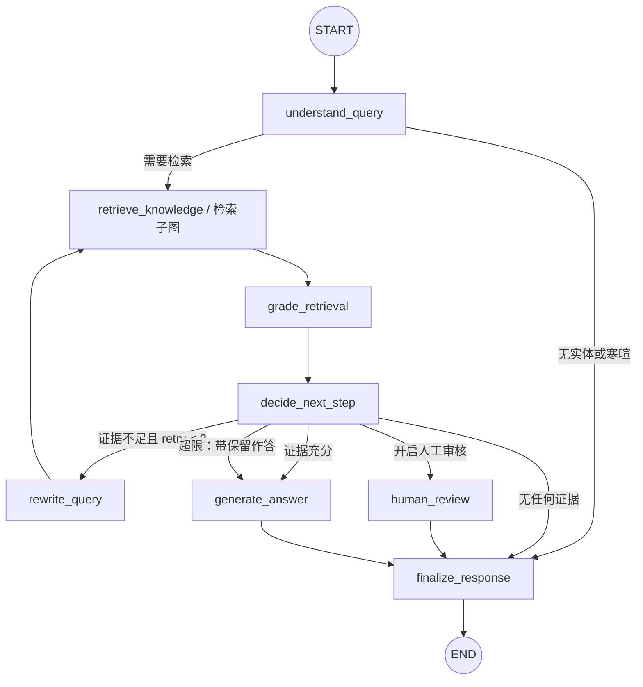
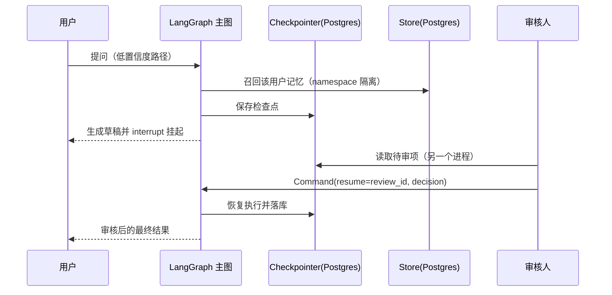

# kb-agent

在已有检索底座（`production-rag`）之上，用 LangGraph 构建一层具备**自我纠错**与
**人工介入**能力的知识问答编排层，并用一份自建的 A 股年报语料，把检索从"够用"
做到"可靠"、给出**可测量的提升**。

一句话分工：`production-rag` 证明"会把检索做扎实"，`sql-mcp-agent` 证明"懂工具、
权限与可观测"，本项目证明"会让 Agent 变可靠"。

本项目**不重做检索**：向量 / BM25 / RRF / Rerank 全部复用 `production-rag`，
开发重点是 LangGraph 的编排、状态与自纠错。

## 当前进度

| 阶段 | 内容 | 状态 |
|---|---|---|
| 第零阶段 | 语料抓取、灌库、20 题 golden set、L0 检索基线 | 已完成：9 份年报 / 3,576 chunk；L0 Recall@5=0.882 |
| 第一阶段 | LangGraph 主图：State / 节点 / 条件边 / 检索子图 / 自纠错重试 | 已完成，见「第一阶段」 |
| 第二阶段 | Postgres Checkpointer、Store 长期记忆、Interrupt 人工审核 | 已完成，见「第二阶段」 |
| 第三阶段 | FastAPI + SSE、分层评估报告、演示与面试材料 | 未开始 |

## 目录结构

```text
kb-agent/
├── agent/            # 主图：state / nodes / graph / grading / rewriter / 检索子图
├── rag_adapter/      # 对 production-rag 的封装：配置、年报装载、检索入口
├── persistence/      # Postgres Checkpointer / Store 装配 + docker-compose
├── api/              # FastAPI 接口与 SSE（第三阶段）
├── configs/          # kb_agent.yaml（本地轻量检索配置）
├── scripts/          # 抓取年报、灌库、原文定位
├── evals/            # golden_set.jsonl、run_eval.py、baseline.json、reports/
├── data/docs/        # annual_reports/（PDF + 抓取登记表）
├── tests/
└── README.md
```

## 环境搭建

```powershell
# 1) 独立 venv（不要把依赖混装进 production-rag 的环境）
D:\Python\Python312\python.exe -m venv .venv
.\.venv\Scripts\python.exe -m pip install -r requirements.txt   # 含 production-rag 依赖 + PDFium + LangGraph
.\.venv\Scripts\python.exe -m pip install -e ..\production-rag  # 同进程 import，方案 §2.2

# 2) 密钥
Copy-Item .env.example .env     # 填入 DASHSCOPE_API_KEY
```

模型（`BAAI/bge-small-zh-v1.5`、`BAAI/bge-reranker-base`）走本机 HuggingFace 缓存，
离线可用：`HF_HUB_OFFLINE=1`。

## 第零阶段：数据与基线

### 1. 语料

三家 A 股公司 × 近三年（2023/2024/2025）共 9 份年报，来自巨潮资讯公告接口：

| 公司 | 代码 | 选它的原因 |
|---|---|---|
| 贵州茅台 | 600519 | 消费、表格规整，适合表格题 |
| 宁德时代 | 300750 | 制造、附注长，且两年披露单位不同（万元 / 千元） |
| 招商银行 | 600036 | 金融、科目体系不同，适合跨文档对比 |

```powershell
python scripts/fetch_annual_reports.py --out-dir data/docs/annual_reports
```

抓取结果登记在 `data/docs/annual_reports/metadata.json`：公告标题、公告 ID、
PDF 直链、字节数、sha256、抓取时间。**只有登记表进 git，PDF 不进**（体积大、可重抓）。

抓取要点（都已实测）：

- 查询接口 `POST http://www.cninfo.com.cn/new/hisAnnouncement/query` **必须带 User-Agent**。
- 沪市可用 `stock="600519,gssh0600519"`；深市 orgId 前缀无稳定规律（300750 各种
  前缀组合都返回 0 条），改用 `searchkey="宁德时代"` 更稳。
- 返回体含 `<em>` 高亮标签，需要先剥标签再匹配标题。
- 标题过滤要排除 `摘要 / 英文 / 更正 / 已取消 / 半年 / 季度` 等干扰项。

### 1b. 辅库：LangGraph 官方文档

```powershell
python scripts/fetch_langgraph_docs.py      # 默认走镜像，网络可直连时加 --upstream
```

两个实测到的坑：`langchain-ai/langgraph` 仓库的 `docs/` 现在只剩重定向配置，
正文已迁到独立的 `langchain-ai/docs` 仓库；本机直连 github.com 超时。因此脚本改为
从 `langchain-ai/docs` 稀疏检出 `src/oss/langgraph`（43 篇 md/mdx，约 1.2 MB），
并把 upstream / 实际使用的镜像 / commit / 文件数写入
`data/docs/langgraph_docs_registry.json`。

**辅库暂未灌入索引**：L0/L1/L2 基线固定在 9 份年报语料上，避免语料一变动基线就不可比。
技术问答题属于 50 题扩展集的范围，接入时建议单独一个索引/命名空间。

### 2. PDF 文本抽取：改用 PDFium（有实测证据的决策）

`production-rag` 默认用 `pypdf` 抽文本。实测 2026-10-13：

| 文件 | pypdf | PDFium |
|---|---|---|
| 600036_2023（招商银行） | 206,412 字符；"营业收入" 命中 **0** 次，正文是乱码（`2023čAĎ`） | **392,667** 字符；"营业收入" 20 次、"净利润" 29 次、"不良贷款" 20 次 |
| 600519_2023（贵州茅台） | 160,667 字符，可用 | 150,622 字符（按清洗后统计算），可用 |

招商银行年报正文使用字体子集且缺少 ToUnicode 映射，`pypdf` 抽出来是乱码，
整个招行语料不可检索——这正是方案 §5.2 预判的"版式导致检索明显失败"。
因此**升级文本抽取这一步，且只保留一条管线**：kb-agent 的 PDF 抽取统一走
PDFium（`rag_adapter/pdfium_loader.py`），切片 / embedding / FAISS 写入仍完全
复用 `production-rag`，不引入第二条解析管线。

抽取时逐页按 `production-rag` 的 `DocumentCleaner` 规则清洗后再拼接，并把
每页的字符区间写进 `data/index/{strategy}/page_offsets.json`，
使检索命中的 `start_offset` 能回落到**原文页码**（引用可追溯）。

### 3. 灌库

```powershell
python scripts/ingest_kb.py                  # 重建 recursive 索引
python scripts/ingest_kb.py --strategy fixed
```

索引落在 `data/index/recursive/`：`faiss.index`（flat 精确检索）+ `metadata.json`
（chunk 正文、偏移、来源元数据）。不启用 MySQL / ES / Milvus / Redis / 鉴权 / 审计
（`configs/kb_agent.yaml`），第零阶段零外部服务依赖。

### 4. Golden Set（20 题）

`evals/golden_set.jsonl`，按方案 §6.1 的 P0 配比：事实型 5、表格型 4、跨章节 3、
跨文档 3、计算型 2、应拒答 3。**每题都回原文核对过**，并记录出处页码。

每条字段：

```json
{"id":"ar-table-001","question":"宁德时代2024年研发费用明细中，职工薪酬是多少千元？",
 "question_type":"table","expected_behavior":"answer",
 "expected_docs":[{"company":"宁德时代","year":2024,"ts_code":"300750"}],
 "expected_keywords":["研发费用","职工薪酬"],
 "expected_values":[{"label":"研发费用-职工薪酬","value":7561191,"unit":"千元","display":"7,561,191"}],
 "source_pages":[{"doc":"300750-2024","page":198}],
 "notes":"附注53 研发费用明细表"}
```

- `question_type`：`fact` / `table` / `cross_section` / `cross_document` / `calc` / `refuse`
- `expected_behavior`：`answer` / `refuse` / `human_review`，让"该不该答"也能自动判定
- `expected_docs` 是单数 `expected_doc` 的扩展，用来表达跨文档题需要召回的那几份年报
- `source_pages` 记录核对出处（工具：`python scripts/report_lookup.py`）

### 5. 分层检索评估

```powershell
python evals/run_eval.py                  # L0/L1/L2
python evals/run_eval.py --layers L0      # 只跑基线
```

| 层 | 说明 | 变量 |
|---|---|---|
| L0 | 单路向量（基线） | — |
| L1 | + BM25 + RRF | 检索方式 |
| L2 | + Cross-Encoder Rerank | 重排开关 |
| L3 | + 自纠错重试（第一阶段） | 待实现 |

指标定义见 `evals/run_eval.py` 顶部注释：`doc_recall@5`、`all_docs_hit@5`、
`doc_mrr`、`value_hit_rate`、`evidence_hit@5`，应拒答题单列 top-1 相似度分布
（为第一阶段的评分阈值提供依据）。

L0 基线写入 `evals/baseline.json`（方案 §6.4 规则 2：灌库完成后立即测出），
各层汇总写入 `evals/reports/layer_matrix.json`。

### 6. 第零阶段结果（实测，2026-10-13）

环境：9 份年报 / 3,576 chunk / `BAAI/bge-small-zh-v1.5` / `BAAI/bge-reranker-base` /
chunk 800·overlap 120 / strategy=recursive / top_k=5 / faiss 1.15.1。

| 层 | 说明 | Recall@5 | 全命中率 | MRR | 证据命中@5 |
|---|---|---|---|---|---|
| L0 | 单路向量（基线） | 0.882 | 0.824 | 0.706 | 0.235 |
| L1 | + BM25 + RRF | 0.912 | 0.882 | 0.726 | 0.588 |
| L2 | + Cross-Encoder Rerank | **1.000** | **1.000** | **0.926** | 0.706 |

> 修正说明：L2 最初测出 0.941/0.941/0.784，是因为评估脚本直接调了
> `pipeline.retriever.search()`，只拿到"更宽候选池 + RRF 排序"，**跳过了真正的
> Cross-Encoder 重排**。`rag_adapter/rag.py::retrieve()` 已改为复刻 pipeline 的
> 检索段（候选池 → 活跃版本过滤 → 重排 → 截断），上表是重排真正生效后的数字。
> 这次修正也说明：分层矩阵的每一层必须验证"这一层声称的机制确实被执行了"。

`全命中率` = 多文档题的期望文档是否全部进入 top-5；`证据命中@5` = top-5 片段里
是否出现该题全部期望数值（证据级，比文档级更严格）。可答题 17 道参与上述指标，
3 道应拒答题单列。

**三个值得写进面试的发现：**

1. **文档级召回高、证据级命中低（L0：0.882 → 0.235）**。典型失败是
   "贵州茅台2023年营业收入"这类问题：top-1 命中 `600519-2025`（同一家公司的
   另一年），文档对了、片段错了。同公司不同年份的语料语义高度相似，
   相似度排序无法区分年份——这正是编排层要做"证据是否足以回答"判定的原因。
2. **应拒答题不能靠相似度阈值拦**。应拒答题 top-1 分数 0.609/0.615/0.725，
   可答题 top-1 分数区间 0.664~0.802，**区间重叠**：没有任何阈值能同时
   "拦住该拒答的"和"放过该回答的"。第一阶段的评分节点必须用关键词覆盖 /
   可答性判定，而不是单看相似度。（另注：L1/L2 的分数来自 RRF，刻度是
   0.03 量级，与 L0 的余弦分数不可比，阈值不能跨层复用。）
3. **跨文档多值题在 top-5 内凑不齐**：`ar-multi-001`（茅台三年营收）、
   `ar-multi-002`（宁德两年营收）、`ar-calc-002`（两年差额）在 L0~L2 全部
   证据未命中，即使文档级召回已命中。要凑齐必须多轮检索或先把问题拆成子问题
   ——这是第一阶段自纠错（改写/拆分重试）要证明收益的地方，也是 L3 的基线。

复现：

```powershell
python scripts/fetch_annual_reports.py --out-dir data/docs/annual_reports
python scripts/ingest_kb.py
python evals/run_eval.py
python -m pytest tests -q
```

## 第一阶段：LangGraph 主图

目标：跑通最小 Agent 闭环——问题理解 → 检索 → 质量判断 → 有限重试 → 带引用作答，
并把观测点（每轮评分、改写、重试次数、失败原因）全部写进 State，随 checkpointer 落库。



**节点职责与状态变更**

| 节点 | 职责 | 主要写回字段 |
|---|---|---|
| `understand_query` | 抽取年份/公司/指标要素，判断是否需要检索 | `facets` `needs_retrieval` `sub_queries` |
| `retrieve_knowledge` | 调用检索子图（多子查询合并去重） | `retrieved_chunks` `retrieval_stats` |
| `grade_retrieval` | 规则评分：年份/公司/关键词覆盖 | `retrieval_score` |
| `decide_next_step` | 依评分与重试次数决定下一步 | `next_action` `needs_human_review` `status` |
| `rewrite_query` | 改写查询或拆子问题，记录失败原因 | `rewritten_query` `sub_queries` `retry_count` `rewrite_history` |
| `generate_answer` | 组装上下文、生成答案、提取引用 | `answer` `citations` `context_chunks` |
| `human_review` | `interrupt()` 挂起草稿，`Command(resume=...)` 恢复后按 approve/reject/supplement 收敛 | `review_result` `answer` `status` |
| `remember_preference` | 写入跨会话记忆；记忆请求在此给回执 | `memory_written` `status` |
| `finalize_response` | 收敛答案与状态，追加 assistant 消息 | `answer` `status` `messages` |

**State 与 reducer**

| 字段 | 语义 | 更新方式 |
|---|---|---|
| `messages` | 线程内对话消息 | `add_messages` 累积，不覆盖历史 |
| `trace` / `rewrite_history` | 节点级执行痕迹、每轮改写记录 | `operator.add` 累积 |
| `retrieved_chunks` / `retrieval_score` / `retry_count` / `next_action` | 当前轮的证据、评分、重试次数与决策 | 覆盖写（只反映当前这轮，避免体积膨胀） |
| `answer` / `citations` / `context_chunks` | 答案、引用、生成时实际使用的片段（`[1][2]` 与它一一对应） | 覆盖写 |
| `needs_human_review` / `review_result` | 待审标记与审核结果（第二阶段用 `Command` 回填） | 覆盖写 |

**职责边界（与方案 §2.2 一致）**

检索子图（`agent/retrieval_subgraph.py`）只做"检索 + 合并去重 + 返回候选与检索统计"，
**不做相关性判定、不自环重试**，所以它是无状态的、可以独立单测；
判定（`grade_retrieval`）与重试（`decide_next_step` / `rewrite_query`）全部在主图，
每轮的失败原因会回灌给改写器。

**评分为什么不看分数阈值**

第零阶段实测：应拒答题的 top-1 相似度（0.609/0.615/0.725）与可答题（0.664~0.802）
区间重叠，而且 L0 用余弦、L1/L2 用 RRF/重排分数，刻度不可比。
所以 `grade_retrieval` 以"问题要素是否被证据覆盖"为准：① 问题里的每个年份都要有
对应年份年报的片段（同公司不同年份语义高度相似，这是 L0 最典型的失败）；
② 语料公司名要出现在证据文本里；③ 指标关键词覆盖率 ≥ 0.6。分数只记录不判定。

**重试策略（v2 §4.1）**

- 上限 2 次；每轮把"失败原因 + 已试查询"喂给改写器（LLM 改写优先，异常时规则兜底）。
- 改写动作对应两类实测失败：补全年份/实体；多个年份或多家公司时拆成多条子查询
  （子查询分别检索后按 chunk_id 合并、取最高分）。
- 超限后：有证据则"基于现有证据作答并要求声明不确定"，同时置 `needs_human_review`；
  完全无证据则直接拒答且**不调用 LLM**，避免编造。
- `--interrupt`（`interrupt_on_low_confidence`）让低置信度先出草稿再挂到 `human_review`，
  由 `Command(resume=...)` 恢复（见第二阶段）。

**Checkpointer**

`build_graph(runtime, checkpointer=...)` 的 checkpointer 默认为 `InMemorySaver`，
第二阶段换成 Postgres 实现即可（同一 `thread_id` 下多次 `ask()` 即多轮对话）。
本阶段不接 Postgres，是因为方案 §7 把持久化与重启恢复放在第二阶段验收。

**跑一次 / 跑测试**

```powershell
python scripts/ask.py "贵州茅台2023年的营业收入是多少元？" --verbose
python scripts/ask.py "宁德时代2023年与2025年的营业收入分别是多少？" --no-generate
python evals/run_agent_eval.py            # L3：自纠错重试（默认 LLM 改写）
python -m pytest tests -q                 # 20 passed
```

**L3 结果（在 L2 配置上叠加自纠错）**

| 层 | 说明 | Recall@5 | 全命中率 | MRR | 证据命中@5 | 证据命中（实际预算） |
|---|---|---|---|---|---|---|
| L0 | 单路向量（基线） | 0.882 | 0.824 | 0.706 | 0.235 | — |
| L1 | + BM25 + RRF | 0.912 | 0.882 | 0.726 | 0.353 | — |
| L2 | + Cross-Encoder Rerank | **1.000** | **1.000** | 0.926 | 0.471 | — |
| L3 | + 自纠错重试（本项目） | **1.000** | **1.000** | **0.9265** | 0.471 | **0.529** |

17 道可答题参与指标；3 道应拒答题单列（L3 把它们全部标成低置信度/待审，
`refuse_flagged_rate = 1.0`）。L3 其余观测：`retry_rate = 0.6`、
`mean_retries = 1.1`、`mean_evidence_count = 13.05`、单题 74.8s（CPU 重排占绝大部分）。

**怎么读这张表（结论比数字重要）**

1. **L2 的文档级检索已经饱和**：Recall@5 = 1.000、全命中 = 1.000。所以 L3 不可能在
   文档级再涨——脚本逐题核对过，**L3 的 top-5 与 L2 完全一致（0 处差异）**，这是设计使然：
   首轮检索与 L2 同参，重试只做"追加证据"，不做覆盖。任何"L3 文档召回更高"的说法都是假的。
2. **编排层的增量只能体现在证据完整度**：0.471 → 0.529（多拿到 1 道题的完整证据，
   即 `ar-multi-002` 宁德时代两年营收这类跨文档多值题）。这个数字小，但它是可复现、
   可归因的净增量，也是本阶段唯一能拿出的"编排层有价值"的证据。
3. **为什么只有 +1 题**：诊断脚本（`evals/diagnose_missing_evidence.py`）给出两类原因：
   - **排序问题**：茅台两道"元级"数字题，含答案的片段排在 rerank 第 6 / 第 16 位，
     放宽预算就能拿到——但这两题的规则评分**判成了"证据已覆盖"**（年份/公司/关键词都对），
     于是根本没触发重试。这是 grader 的盲区：它看不出"缺的是那个具体数字"。
   - **度量口径问题**：计算题（如"增加约多少亿元"）的期望值是算出来的，
     原文里不存在该字面量。已在 golden set 里为这类题补 `evidence_literals`，
     用原文真实出现的数字做证据级判定（口径修正后 L1/L2 的证据命中从 0.588/0.706 降到
     0.353/0.471，之前的偏高是虚的）。
4. **下一步最明确的一个动作**：给 `grade_retrieval` 加上"证据里是否出现了可用数值"的判定
   （方案 §4.1 允许的"必要时再用一次轻量 LLM 评分"），把上面第 1 类失败纳入重试触发条件。
   这是当前唯一能继续抬高 L3 证据命中的低风险办法。

## 第二阶段：状态持久化与人工介入

目标：把"进程内存里的对话"变成"可恢复的线程"，把"自动作答"接上"人工把关"。

**Checkpointer 与 Store 的区别**（v2 §4.4 / §4.5，面试要能一句话说清）

| | Checkpointer | Store |
|---|---|---|
| 存什么 | 某个线程执行到哪了（State、下一步、待审中断） | 跨线程仍然成立的记忆（用户偏好、业务约定） |
| 生命周期 | 随线程；恢复、继续执行、时间旅行 | 跨会话长期有效 |
| 命名空间 | thread_id | `("kb-agent","users",{user_id},"memories")` |
| 不是 | 聊天记录表、也不是知识库 | 不是知识库文档的收纳处 |

两者共用同一套 Postgres（`persistence/docker-compose.yml`，容器名 `kb-agent-postgres`，
端口 5433，独立数据卷），但职责完全分开。



**起环境**

```powershell
docker compose -f persistence/docker-compose.yml up -d      # 在 WSL 里执行
python scripts/memories.py --user alice --add "记住我以后都用表格回答"
python scripts/memories.py --user alice --list              # 另一个进程仍能看到
python scripts/memories.py --user bob --list                # bob 看不到 alice 的（隔离）
python scripts/ask.py "比亚迪2024年的营业收入是多少？" --postgres --interrupt
python scripts/review_cli.py --thread demo-review --list     # 拿到 review_id
python scripts/review_cli.py --thread demo-review --review-id <id> --decision reject
```

**实测记录（2026-10-13，都跨进程）**

- 长期记忆：`alice` 写入 1 条 → 新进程读到 1 条；`bob` 读到 0 条（namespace 隔离）。
- 重启恢复：子进程写入第 1 轮，**另一个子进程**在同一 `thread_id` 上读到并累加到第 2 轮
  （`tests/test_persistence.py::test_checkpointer_persists_thread_across_graph_instances`）。
- 人工审核：`比亚迪2024年营业收入` 这类"语料没有"的问题，规则评分判低置信度 →
  生成草稿（内容正确拒答）→ 在 `human_review` 处挂起；另一个进程 `review_cli --list`
  能看到 `review_id / question / reason / draft_answer`；提交 `reject` 后恢复为
  `review_rejected`；**同一 `review_id` 重复提交返回 `already_processed`**，
  且不会用后一次 `approve` 覆盖前一次 `reject`。
- 引用可追溯（M6）：适配层把 chunk 的 `start_offset` 映射回原文页码，
  引用从上游的 `file_name=unknown` 变成
  `[1] 贵州茅台2024年年度报告 p.10`（页码取 chunk 起始页，见下"已知限制"）。

**边界与不做的**

- 审核幂等表存在 Store 里（namespace `("kb-agent","reviews")`）；并发只做了**进程内**串行化，
  多副本需要数据库层互斥，列入"明确不达标"。
- 审核超时在提交时判定（`--timeout-seconds`，默认 3600s），没有后台清扫任务。

## 已知限制（不掩盖）

- **上游发布前校验在本机不可用**：`production-rag` 的 FAISS 校验调用
  `index.id_map.tolist()`，而 `faiss>=1.15` 的 `Int64Vector` 已移除该方法
  （production-rag 自己的 venv 也一样报错）。kb-agent 不改动上游代码，
  改为在 `scripts/ingest_kb.py` 里用 `faiss.vector_to_array` 做等效核对
  （metadata.json 与 FAISS 的 vector_id 集合必须一致），并在本地配置里关闭
  上游校验开关。
- 语料只有 3 家公司 × 3 年、共 9 份年报，**不能**据此谈容量或 SLA。
- **证据级指标的口径**：计算题与单位换算题（"增加约多少亿元"）的期望值是算出来的，
  原文里没有该字面量，所以这类题用 `evidence_literals` 声明"证据里必须真实出现的数字"。
  修正口径后 L1/L2 的证据命中是 0.353 / 0.471（此前 0.588 / 0.706 是把"算出来的期望值"
  当字面量匹配导致的虚高）。
- **L3 的增量为 +1 题**（证据命中 0.471 → 0.529）。文档级已饱和，且规则评分存在盲区
  （判不出"缺的是那个具体数字"，见第一阶段第 3 点）。
- **引用页码取 chunk 起始页**：chunk 跨页时给的是首页，不是数字所在页
  （上面的实测里销售费用在 p.11，引用标 p.10）。
- **单题耗时 60~75s**：瓶颈是 CPU 上的 Cross-Encoder 重排（每题候选池 50），
  不是编排层。要进第三阶段必须先解决这个（缓存/并行/缩小候选池），否则 SSE 演示体验会很差。
- 表格在抽取后是"拍平"的文本行，数字顺序保留、行列语义丢失；表格题的召回
  依赖数字与表头关键词共现，不是结构化取数。
- golden set 的 20 题为自建最小集，验收前需扩到 50 题。
- 第零阶段只验证检索层，**答案正确性 / 拒答 / 引用准确率**需要生成链路，
  属于第一阶段及以后。
