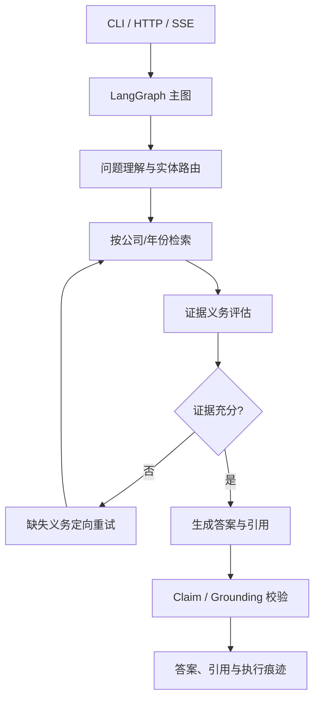

# kb-agent

[](https://github.com/1940633231/kb-agent/actions/workflows/tests.yml)

基于 LangGraph 的年报知识问答 Agent，重点解决多公司、多年份、跨文档检索中的
实体路由、证据完整性、答案审计和可复现评测。

项目不重做向量检索底座，而是在 `production-rag` 的 FAISS、BM25、RRF 和 rerank
之上增加一层可观测、可重试、可人工介入的编排逻辑。

## 当前状态

| 模块 | 状态 |
|---|---|
| 30 家公司、90 份年报、37,958 chunk | 已完成并通过审计 |
| 120 题评测集 v2 | 已完成，`120 normal / 0 fail` |
| 证据义务与 Claim 门禁 | 已完成 |
| 多公司/多年份检索前路由 | 已完成 |
| L2 / L3a / L3b 消融 | 已完成，全部验收通过 |
| 三轮 hybrid L3b 生成 | 已完成 |
| 生成质量优化 | 下一阶段 |

最新评测统一使用：

```text
dataset = evals/golden_set_scaled_120.jsonl
manifest_sha256 = 9b91a2457f47afab5de9968f9dfebef72e72598abdf4e8a58ef95c4e1417d29f
```

详细交付状态见 [docs/final-handoff.md](docs/final-handoff.md)。

## 核心结果

### 检索与路由

| 档位 | Recall@5 | Route 覆盖 | 缺失义务率 | 重试率 | 平均秒/题 | 污染率 |
|---|---:|---:|---:|---:|---:|---:|
| L2 | 0.9762 | 0.9476 | 0.0762 | 0.0000 | 44.6214 | 0.0095 |
| L3a | 1.0000 | 0.9905 | 0.0000 | 0.0000 | 37.2332 | 0.0000 |
| L3b | 1.0000 | 0.9905 | 0.0000 | 0.0917 | 55.4650 | 0.0000 |

正式消融 `acceptance.all_passed=true`。详见
[docs/routing-ablation-results.md](docs/routing-ablation-results.md)。

### 生成

三轮 hybrid L3b，每轮 120 题：

| 指标 | 均值 |
|---|---:|
| 答案正确率 | 0.6603 |
| Claim 支持率 | 0.7988 |
| Grounding 通过率 | 0.9403 |
| 引用完整覆盖率 | 0.9930 |
| 拒答正确率 | 1.0000 |
| 上下文溢出率 | 0.0000 |
| 平均秒/题 | 92.8829 |

分题型答案正确率：

```text
fact = 0.6713
table = 0.7593
cross_document = 0.4889
```

生成质量仍是主要短板。详见
[docs/generation-eval-v2.md](docs/generation-eval-v2.md)。

## 架构



关键原则：

- route 绑定具体 `document_ids`，禁止跨公司、跨年份回退。
- 每个公司 × 年份 × 指标生成独立证据义务。
- 重试只补缺失义务对应 route。
- 生成前统一裁剪上下文预算。
- 生成后做数值落地、引用和 Claim 审计。

## 快速开始

### 1. 安装

```powershell
D:\Python\Python312\python.exe -m venv .venv
.\.venv\Scripts\python.exe -m pip install -r requirements.txt
.\.venv\Scripts\python.exe -m pip install -e ..\production-rag
Copy-Item .env.example .env
```

在 `.env` 中配置：

```text
LLM_BASE_URL=
LLM_API_KEY=
LLM_MODEL=
```

本地模型使用 `BAAI/bge-small-zh-v1.5` 和 `BAAI/bge-reranker-base`。
模型已缓存时可设置：

```powershell
$env:HF_HUB_OFFLINE="1"
```

PDF 和索引不提交 Git，首次运行需要抓取年报并灌库：

```powershell
.\.venv\Scripts\python.exe scripts\fetch_annual_reports.py `
  --targets configs\cninfo_targets.json `
  --years 2023 2024 2025 `
  --out-dir data\docs\annual_reports

.\.venv\Scripts\python.exe scripts\ingest_kb.py --strategy recursive
```

### 2. CLI 问答

```powershell
.\.venv\Scripts\python.exe scripts\ask.py `
  "贵州茅台2023年的营业收入是多少元？"

.\.venv\Scripts\python.exe scripts\ask.py `
  "宁德时代2023年与2025年的营业收入分别是多少？" `
  --no-generate
```

常用参数：

```text
--no-generate     只跑检索与评分
--rule-rewrite    改写使用规则兜底
--interrupt       低置信度时挂起人工审核
--postgres        使用 Postgres Checkpointer / Store
--verbose         打印完整执行痕迹
```

### 3. HTTP API

```powershell
.\.venv\Scripts\python.exe -m api
```

默认地址：`http://127.0.0.1:8300`

| 方法 | 路径 | 用途 |
|---|---|---|
| GET | `/health` | 服务状态 |
| POST | `/ask` | 同步问答 |
| POST | `/ask/stream` | SSE 进度与 token 流 |
| GET | `/threads/{id}` | 查看线程状态 |
| GET | `/threads/{id}/review` | 查看待审核项 |
| POST | `/threads/{id}/review` | 提交审核结果 |

## 评测

### 数据审计

```powershell
.\.venv\Scripts\python.exe evals\audit_scaled_golden_set.py
```

期望结果：

```text
records = 120
normal = 120
fail = 0
```

### 路由消融

```powershell
.\.venv\Scripts\python.exe evals\run_routing_ablation.py `
  --limit 120 `
  --top-k 5 `
  --route-candidate-limit 50 `
  --resume
```

输出：

```text
evals/reports/routing_ablation_l2.json
evals/reports/routing_ablation_l3a.json
evals/reports/routing_ablation_l3b.json
evals/reports/routing_ablation_summary.json
evals/reports/layer_matrix.json
```

### 三轮 hybrid L3b 生成

```powershell
.\.venv\Scripts\python.exe evals\run_scaled_eval.py `
  --mode generation `
  --repeats 3 `
  --generation-mode hybrid `
  --max-retries 2 `
  --top-k 5 `
  --output scaled_generation.json
```

CPU rerank 是主要耗时项。建议在机器空闲时运行，并预留数小时。

### 测试

```powershell
.\.venv\Scripts\python.exe -m pytest tests -q -rs
```

当前：`198 passed, 1 skipped`。跳过项为未配置 Postgres。

## 目录

```text
agent/          LangGraph 状态、节点、路由、证据与审计
api/            FastAPI、SSE、请求日志
rag_adapter/    production-rag 适配和年报 prompt
evals/          数据集、runner、消融与报告
persistence/    Postgres Checkpointer / Store
scripts/        抓取、灌库、CLI 与审核工具
tests/          单元、图、API、持久化和报告契约测试
docs/           设计、评测、交付与历史文档
```

## 已知限制

- 跨文档生成答案正确率为 `0.4889`，多值题仍容易漏答或错绑。
- Claim 支持率为 `0.798833`，低于 `0.8` 优化门槛。
- 表格在 PDF 抽取后是扁平文本，行列语义仍需模型推断。
- hybrid L3b 平均约 92.88 秒/题，瓶颈主要是 CPU reranker。
- Postgres 未配置时退化到内存 Checkpointer，不能跨进程恢复审核状态。
- 引用页码使用 chunk 起始页，跨页片段可能指向上一页。

## 文档索引

| 文档 | 内容 |
|---|---|
| [final-handoff.md](docs/final-handoff.md) | 当前阶段最终交付说明 |
| [routing-ablation-results.md](docs/routing-ablation-results.md) | 120 题路由消融 |
| [generation-eval-v2.md](docs/generation-eval-v2.md) | 三轮 hybrid L3b 生成 |
| [reliability-and-corpus-plan.md](docs/reliability-and-corpus-plan.md) | 数据与可靠性补强计划 |
| [pre-retrieval-entity-routing-plan.md](docs/pre-retrieval-entity-routing-plan.md) | 检索前实体路由设计 |
| [rag_eval_integration.md](docs/rag_eval_integration.md) | rag-eval 平台接入 |
| [interview.md](docs/interview.md) | 项目讲解与追问材料 |
| [readme-archive.md](docs/readme-archive.md) | 旧版 README 与历史阶段记录 |
