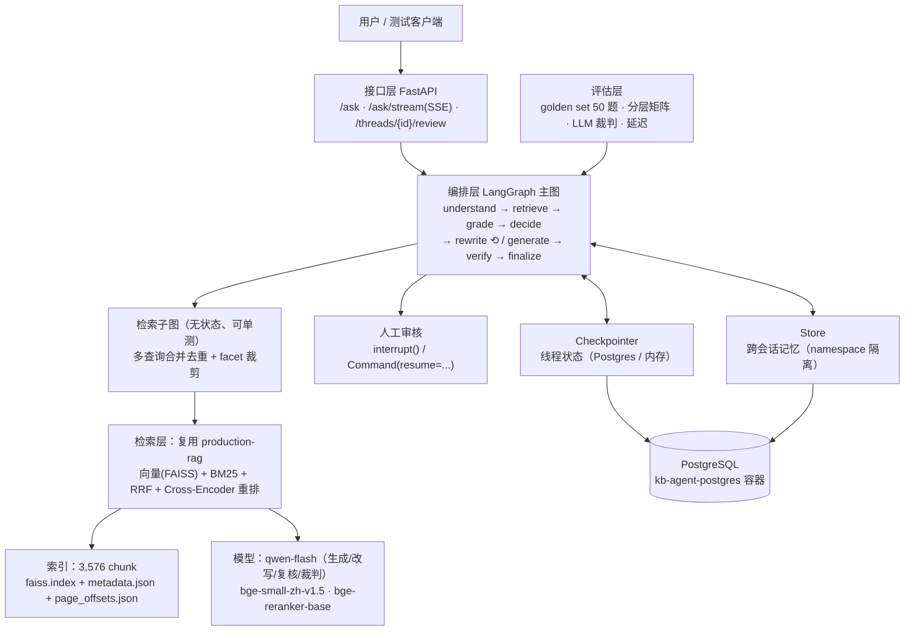
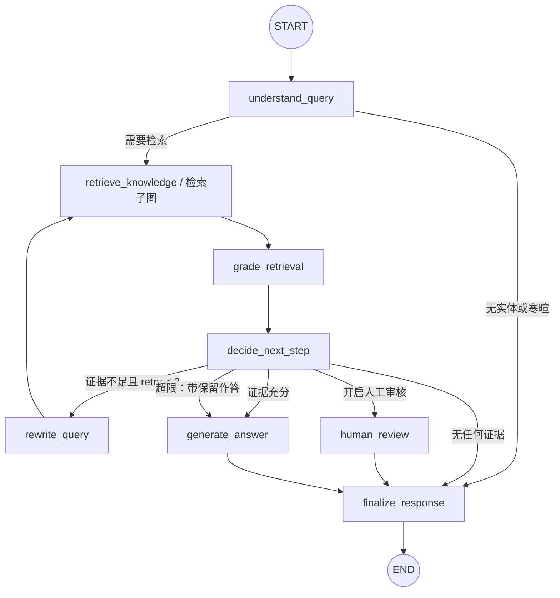
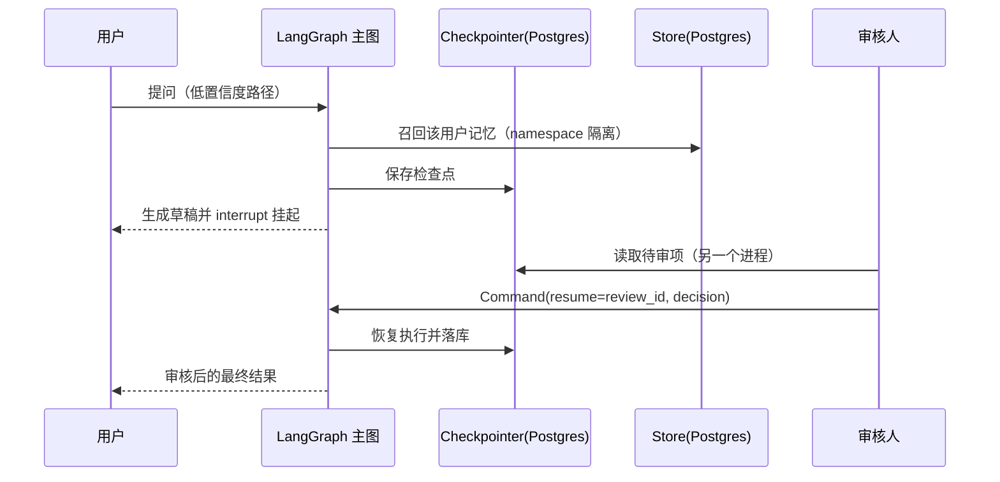

# kb-agent

[](https://github.com/1940633231/kb-agent/actions/workflows/tests.yml)

在已有检索底座（`production-rag`）之上，用 LangGraph 构建一层具备**自我纠错**与
**人工介入**能力的知识问答编排层，并用一份自建的 A 股年报语料，把检索从"够用"
做到"可靠"、给出**可测量的提升**。

一句话分工：`production-rag` 证明"会把检索做扎实"，`sql-mcp-agent` 证明"懂工具、
权限与可观测"，本项目证明"会让 Agent 变可靠"。

本项目**不重做检索**：向量 / BM25 / RRF / Rerank 全部复用 `production-rag`，
开发重点是 LangGraph 的编排、状态与自纠错。

## 当前进度

| 阶段 | 内容 | 状态 |
|---|---|---|
| 第零阶段 | 语料抓取、灌库、20 题 golden set、L0 检索基线 | 已完成：9 份年报 / 3,576 chunk；L0 Recall@5=0.882 |
| 第一阶段 | LangGraph 主图：State / 节点 / 条件边 / 检索子图 / 自纠错重试 | 已完成，见「第一阶段」 |
| 第二阶段 | Postgres Checkpointer、Store 长期记忆、Interrupt 人工审核 | 已完成，见「第二阶段」 |
| 第三阶段 | FastAPI + SSE、结构化日志、四场景演示 | 已完成，见「第三阶段」 |
| 验收 | 50 题验收集、CI、成本与延迟、面试材料 | 已完成，见「验收相关的工程配置」 |

## 目录结构

### 总体架构（分层）



边界说明：检索子图只返回候选与检索统计，**判定与重试全部在编排层**；
接口层只做 HTTP 语义（校验、错误映射、SSE 编码、请求级日志），不复制判定逻辑。

```text
kb-agent/
├── agent/            # 主图：state / nodes / graph / grading / rewriter / 检索子图
├── rag_adapter/      # 对 production-rag 的封装：配置、年报装载、检索入口
├── persistence/      # Postgres Checkpointer / Store 装配 + docker-compose
├── api/              # FastAPI 接口、SSE 事件流、结构化日志
├── configs/          # kb_agent.yaml（本地轻量检索配置）
├── scripts/          # 抓取年报、灌库、原文定位
├── evals/            # golden_set.jsonl、run_eval.py、baseline.json、reports/
├── data/docs/        # annual_reports/（PDF + 抓取登记表）
├── tests/
└── README.md
```

## 环境搭建

```powershell
# 1) 独立 venv（不要把依赖混装进 production-rag 的环境）
D:\Python\Python312\python.exe -m venv .venv
.\.venv\Scripts\python.exe -m pip install -r requirements.txt   # 含 production-rag 依赖 + PDFium + LangGraph
.\.venv\Scripts\python.exe -m pip install -e ..\production-rag  # 同进程 import，方案 §2.2

# 2) 密钥
Copy-Item .env.example .env     # 填入 DASHSCOPE_API_KEY
```

模型（`BAAI/bge-small-zh-v1.5`、`BAAI/bge-reranker-base`）走本机 HuggingFace 缓存，
离线可用：`HF_HUB_OFFLINE=1`。

## 第零阶段：数据与基线

### 1. 语料

三家 A 股公司 × 近三年（2023/2024/2025）共 9 份年报，来自巨潮资讯公告接口：

| 公司 | 代码 | 选它的原因 |
|---|---|---|
| 贵州茅台 | 600519 | 消费、表格规整，适合表格题 |
| 宁德时代 | 300750 | 制造、附注长，且两年披露单位不同（万元 / 千元） |
| 招商银行 | 600036 | 金融、科目体系不同，适合跨文档对比 |

```powershell
python scripts/fetch_annual_reports.py --out-dir data/docs/annual_reports
```

抓取结果登记在 `data/docs/annual_reports/metadata.json`：公告标题、公告 ID、
PDF 直链、字节数、sha256、抓取时间。**只有登记表进 git，PDF 不进**（体积大、可重抓）。

抓取要点（都已实测）：

- 查询接口 `POST http://www.cninfo.com.cn/new/hisAnnouncement/query` **必须带 User-Agent**。
- 沪市可用 `stock="600519,gssh0600519"`；深市 orgId 前缀无稳定规律（300750 各种
  前缀组合都返回 0 条），改用 `searchkey="宁德时代"` 更稳。
- 返回体含 `<em>` 高亮标签，需要先剥标签再匹配标题。
- 标题过滤要排除 `摘要 / 英文 / 更正 / 已取消 / 半年 / 季度` 等干扰项。

### 1b. 辅库：LangGraph 官方文档

```powershell
python scripts/fetch_langgraph_docs.py      # 默认走镜像，网络可直连时加 --upstream
```

两个实测到的坑：`langchain-ai/langgraph` 仓库的 `docs/` 现在只剩重定向配置，
正文已迁到独立的 `langchain-ai/docs` 仓库；本机直连 github.com 超时。因此脚本改为
从 `langchain-ai/docs` 稀疏检出 `src/oss/langgraph`（43 篇 md/mdx，约 1.2 MB），
并把 upstream / 实际使用的镜像 / commit / 文件数写入
`data/docs/langgraph_docs_registry.json`。

**辅库暂未灌入索引**：L0/L1/L2 基线固定在 9 份年报语料上，避免语料一变动基线就不可比。
技术问答题属于 50 题扩展集的范围，接入时建议单独一个索引/命名空间。

### 2. PDF 文本抽取：改用 PDFium（有实测证据的决策）

`production-rag` 默认用 `pypdf` 抽文本。实测 2026-10-13：

| 文件 | pypdf | PDFium |
|---|---|---|
| 600036_2023（招商银行） | 206,412 字符；"营业收入" 命中 **0** 次，正文是乱码（`2023čAĎ`） | **392,667** 字符；"营业收入" 20 次、"净利润" 29 次、"不良贷款" 20 次 |
| 600519_2023（贵州茅台） | 160,667 字符，可用 | 150,622 字符（按清洗后统计算），可用 |

招商银行年报正文使用字体子集且缺少 ToUnicode 映射，`pypdf` 抽出来是乱码，
整个招行语料不可检索——这正是方案 §5.2 预判的"版式导致检索明显失败"。
因此**升级文本抽取这一步，且只保留一条管线**：kb-agent 的 PDF 抽取统一走
PDFium（`rag_adapter/pdfium_loader.py`），切片 / embedding / FAISS 写入仍完全
复用 `production-rag`，不引入第二条解析管线。

抽取时逐页按 `production-rag` 的 `DocumentCleaner` 规则清洗后再拼接，并把
每页的字符区间写进 `data/index/{strategy}/page_offsets.json`，
使检索命中的 `start_offset` 能回落到**原文页码**（引用可追溯）。

### 3. 灌库

```powershell
python scripts/ingest_kb.py                  # 重建 recursive 索引
python scripts/ingest_kb.py --strategy fixed
```

索引落在 `data/index/recursive/`：`faiss.index`（flat 精确检索）+ `metadata.json`
（chunk 正文、偏移、来源元数据）。不启用 MySQL / ES / Milvus / Redis / 鉴权 / 审计
（`configs/kb_agent.yaml`），第零阶段零外部服务依赖。

### 4. Golden Set（22 题 = 20 题 P0 最小集 + 2 题跨公司）

`evals/golden_set.jsonl`，按方案 §6.1 的 P0 配比：事实型 5、表格型 4、跨章节 3、
跨文档 3、计算型 2、应拒答 3，另加 **2 题跨公司对比题**（`ar-crossco-001/002`）。
**每题都回原文核对过**，并记录出处页码。

加这两题的原因：原 20 题**每题只点名一家公司**，公司交叉这个维度根本没有被覆盖。
补上之后，"把两家的数字张冠李戴"才可被自动检出（跨公司 + 单位不同 + 指标口径不同）。

每条字段：

```json
{"id":"ar-table-001","question":"宁德时代2024年研发费用明细中，职工薪酬是多少千元？",
 "question_type":"table","expected_behavior":"answer",
 "expected_docs":[{"company":"宁德时代","year":2024,"ts_code":"300750"}],
 "expected_keywords":["研发费用","职工薪酬"],
 "expected_values":[{"label":"研发费用-职工薪酬","value":7561191,"unit":"千元","display":"7,561,191"}],
 "source_pages":[{"doc":"300750-2024","page":198}],
 "notes":"附注53 研发费用明细表"}
```

- `question_type`：`fact` / `table` / `cross_section` / `cross_document` / `calc` / `refuse`
- `expected_behavior`：`answer` / `refuse` / `human_review`，让"该不该答"也能自动判定
- `expected_docs` 是单数 `expected_doc` 的扩展，用来表达跨文档题需要召回的那几份年报
- `source_pages` 记录核对出处（工具：`python scripts/report_lookup.py`）

### 5. 分层检索评估

```powershell
python evals/run_eval.py                  # L0/L1/L2
python evals/run_eval.py --layers L0      # 只跑基线
```

| 层 | 说明 | 变量 |
|---|---|---|
| L0 | 单路向量（基线） | — |
| L1 | + BM25 + RRF | 检索方式 |
| L2 | + Cross-Encoder Rerank | 重排开关 |
| L3 | + 自纠错重试（第一阶段） | 待实现 |

指标定义见 `evals/run_eval.py` 顶部注释：`doc_recall@5`、`all_docs_hit@5`、
`doc_mrr`、`value_hit_rate`、`evidence_hit@5`，应拒答题单列 top-1 相似度分布
（为第一阶段的评分阈值提供依据）。

L0 基线写入 `evals/baseline.json`（方案 §6.4 规则 2：灌库完成后立即测出），
各层汇总写入 `evals/reports/layer_matrix.json`。

### 6. 第零阶段结果（实测，2026-10-13）

环境：9 份年报 / 3,576 chunk / `BAAI/bge-small-zh-v1.5` / `BAAI/bge-reranker-base` /
chunk 800·overlap 120 / strategy=recursive / top_k=5 / faiss 1.15.1。

| 层 | 说明 | Recall@5 | 全命中率 | MRR | 证据命中@5 |
|---|---|---|---|---|---|
| L0 | 单路向量（基线） | 0.882 | 0.824 | 0.706 | 0.235 |
| L1 | + BM25 + RRF | 0.912 | 0.882 | 0.726 | 0.588 |
| L2 | + Cross-Encoder Rerank | **1.000** | **1.000** | **0.926** | 0.706 |

> 修正说明：L2 最初测出 0.941/0.941/0.784，是因为评估脚本直接调了
> `pipeline.retriever.search()`，只拿到"更宽候选池 + RRF 排序"，**跳过了真正的
> Cross-Encoder 重排**。`rag_adapter/rag.py::retrieve()` 已改为复刻 pipeline 的
> 检索段（候选池 → 活跃版本过滤 → 重排 → 截断），上表是重排真正生效后的数字。
> 这次修正也说明：分层矩阵的每一层必须验证"这一层声称的机制确实被执行了"。

`全命中率` = 多文档题的期望文档是否全部进入 top-5；`证据命中@5` = top-5 片段里
是否出现该题全部期望数值（证据级，比文档级更严格）。可答题 17 道参与上述指标，
3 道应拒答题单列。

**三个值得写进面试的发现：**

1. **文档级召回高、证据级命中低（L0：0.882 → 0.235）**。典型失败是
   "贵州茅台2023年营业收入"这类问题：top-1 命中 `600519-2025`（同一家公司的
   另一年），文档对了、片段错了。同公司不同年份的语料语义高度相似，
   相似度排序无法区分年份——这正是编排层要做"证据是否足以回答"判定的原因。
2. **应拒答题不能靠相似度阈值拦**。应拒答题 top-1 分数 0.609/0.615/0.725，
   可答题 top-1 分数区间 0.664~0.802，**区间重叠**：没有任何阈值能同时
   "拦住该拒答的"和"放过该回答的"。第一阶段的评分节点必须用关键词覆盖 /
   可答性判定，而不是单看相似度。（另注：L1/L2 的分数来自 RRF，刻度是
   0.03 量级，与 L0 的余弦分数不可比，阈值不能跨层复用。）
3. **跨文档多值题在 top-5 内凑不齐**：`ar-multi-001`（茅台三年营收）、
   `ar-multi-002`（宁德两年营收）、`ar-calc-002`（两年差额）在 L0~L2 全部
   证据未命中，即使文档级召回已命中。要凑齐必须多轮检索或先把问题拆成子问题
   ——这是第一阶段自纠错（改写/拆分重试）要证明收益的地方，也是 L3 的基线。

复现：

```powershell
python scripts/fetch_annual_reports.py --out-dir data/docs/annual_reports
python scripts/ingest_kb.py
python evals/run_eval.py
python -m pytest tests -q
```

## 第一阶段：LangGraph 主图

目标：跑通最小 Agent 闭环——问题理解 → 检索 → 质量判断 → 有限重试 → 带引用作答，
并把观测点（每轮评分、改写、重试次数、失败原因）全部写进 State，随 checkpointer 落库。



**节点职责与状态变更**

| 节点 | 职责 | 主要写回字段 |
|---|---|---|
| `understand_query` | 抽取年份/公司/指标要素，判断是否需要检索 | `facets` `needs_retrieval` `sub_queries` |
| `retrieve_knowledge` | 调用检索子图（多子查询合并去重） | `retrieved_chunks` `retrieval_stats` |
| `grade_retrieval` | 规则评分：年份/公司/关键词覆盖 | `retrieval_score` |
| `decide_next_step` | 依评分与重试次数决定下一步 | `next_action` `needs_human_review` `status` |
| `rewrite_query` | 改写查询或拆子问题，记录失败原因 | `rewritten_query` `sub_queries` `retry_count` `rewrite_history` |
| `generate_answer` | 组装上下文、生成答案、提取引用 | `answer` `citations` `context_chunks` |
| `human_review` | `interrupt()` 挂起草稿，`Command(resume=...)` 恢复后按 approve/reject/supplement 收敛 | `review_result` `answer` `status` |
| `remember_preference` | 写入跨会话记忆；记忆请求在此给回执 | `memory_written` `status` |
| `finalize_response` | 收敛答案与状态，追加 assistant 消息 | `answer` `status` `messages` |

**State 与 reducer**

| 字段 | 语义 | 更新方式 |
|---|---|---|
| `messages` | 线程内对话消息 | `add_messages` 累积，不覆盖历史 |
| `trace` / `rewrite_history` | 节点级执行痕迹、每轮改写记录 | `operator.add` 累积 |
| `retrieved_chunks` / `retrieval_score` / `retry_count` / `next_action` | 当前轮的证据、评分、重试次数与决策 | 覆盖写（只反映当前这轮，避免体积膨胀） |
| `answer` / `citations` / `context_chunks` | 答案、引用、生成时实际使用的片段（`[1][2]` 与它一一对应） | 覆盖写 |
| `needs_human_review` / `review_result` | 待审标记与审核结果（第二阶段用 `Command` 回填） | 覆盖写 |

**职责边界（与方案 §2.2 一致）**

检索子图（`agent/retrieval_subgraph.py`）只做"检索 + 合并去重 + 返回候选与检索统计"，
**不做相关性判定、不自环重试**，所以它是无状态的、可以独立单测；
判定（`grade_retrieval`）与重试（`decide_next_step` / `rewrite_query`）全部在主图，
每轮的失败原因会回灌给改写器。

**评分为什么不看分数阈值**

第零阶段实测：应拒答题的 top-1 相似度（0.609/0.615/0.725）与可答题（0.664~0.802）
区间重叠，而且 L0 用余弦、L1/L2 用 RRF/重排分数，刻度不可比。
所以 `grade_retrieval` 以"问题要素是否被证据覆盖"为准：① 问题里的每个年份都要有
对应年份年报的片段（同公司不同年份语义高度相似，这是 L0 最典型的失败）；
② 语料公司名要出现在证据文本里；③ 指标关键词覆盖率 ≥ 0.6。分数只记录不判定。

**重试策略（v2 §4.1）**

- 上限 2 次；每轮把"失败原因 + 已试查询"喂给改写器（LLM 改写优先，异常时规则兜底）。
- 改写动作对应两类实测失败：补全年份/实体；多个年份或多家公司时拆成多条子查询
  （子查询分别检索后按 chunk_id 合并、取最高分）。
- 超限后：有证据则"基于现有证据作答并要求声明不确定"，同时置 `needs_human_review`；
  完全无证据则直接拒答且**不调用 LLM**，避免编造。
- `--interrupt`（`interrupt_on_low_confidence`）让低置信度先出草稿再挂到 `human_review`，
  由 `Command(resume=...)` 恢复（见第二阶段）。

**Checkpointer**

`build_graph(runtime, checkpointer=...)` 的 checkpointer 默认为 `InMemorySaver`，
第二阶段换成 Postgres 实现即可（同一 `thread_id` 下多次 `ask()` 即多轮对话）。
本阶段不接 Postgres，是因为方案 §7 把持久化与重启恢复放在第二阶段验收。

**跑一次 / 跑测试**

```powershell
python scripts/ask.py "贵州茅台2023年的营业收入是多少元？" --verbose
python scripts/ask.py "宁德时代2023年与2025年的营业收入分别是多少？" --no-generate
python evals/run_agent_eval.py            # L3：自纠错重试（默认 LLM 改写）
python -m pytest tests -q                 # 20 passed
```

**L3 结果（在 L2 配置上叠加自纠错）**

> 下表是 20 题基线版；22 题（含 2 道跨公司题）与优化后的数字见「优化轮」。

| 层 | 说明 | Recall@5 | 全命中率 | MRR | 证据命中@5 | 证据命中（实际预算） |
|---|---|---|---|---|---|---|
| L0 | 单路向量（基线） | 0.882 | 0.824 | 0.706 | 0.235 | — |
| L1 | + BM25 + RRF | 0.912 | 0.882 | 0.726 | 0.353 | — |
| L2 | + Cross-Encoder Rerank | **1.000** | **1.000** | 0.926 | 0.471 | — |
| L3 | + 自纠错重试（本项目） | **1.000** | **1.000** | **0.9265** | 0.471 | **0.529** |

17 道可答题参与指标；3 道应拒答题单列（L3 把它们全部标成低置信度/待审，
`refuse_flagged_rate = 1.0`）。L3 其余观测：`retry_rate = 0.6`、
`mean_retries = 1.1`、`mean_evidence_count = 13.05`、单题 74.8s（CPU 重排占绝大部分）。

**怎么读这张表（结论比数字重要）**

1. **L2 的文档级检索已经饱和**：Recall@5 = 1.000、全命中 = 1.000。所以 L3 不可能在
   文档级再涨——脚本逐题核对过，**L3 的 top-5 与 L2 完全一致（0 处差异）**，这是设计使然：
   首轮检索与 L2 同参，重试只做"追加证据"，不做覆盖。任何"L3 文档召回更高"的说法都是假的。
2. **编排层的增量只能体现在证据完整度**：0.471 → 0.529（多拿到 1 道题的完整证据，
   即 `ar-multi-002` 宁德时代两年营收这类跨文档多值题）。这个数字小，但它是可复现、
   可归因的净增量，也是本阶段唯一能拿出的"编排层有价值"的证据。
3. **为什么只有 +1 题**：诊断脚本（`evals/diagnose_missing_evidence.py`）给出两类原因：
   - **排序问题**：茅台两道"元级"数字题，含答案的片段排在 rerank 第 6 / 第 16 位，
     放宽预算就能拿到——但这两题的规则评分**判成了"证据已覆盖"**（年份/公司/关键词都对），
     于是根本没触发重试。这是 grader 的盲区：它看不出"缺的是那个具体数字"。
   - **度量口径问题**：计算题（如"增加约多少亿元"）的期望值是算出来的，
     原文里不存在该字面量。已在 golden set 里为这类题补 `evidence_literals`，
     用原文真实出现的数字做证据级判定（口径修正后 L1/L2 的证据命中从 0.588/0.706 降到
     0.353/0.471，之前的偏高是虚的）。
4. **下一步最明确的一个动作**：给 `grade_retrieval` 加上"证据里是否出现了可用数值"的判定
   （方案 §4.1 允许的"必要时再用一次轻量 LLM 评分"），把上面第 1 类失败纳入重试触发条件。
   这是当前唯一能继续抬高 L3 证据命中的低风险办法。

**生成链路结果（20 题全量跑，`python evals/run_agent_eval.py --generate`）**

| 指标 | 值 | 说明 |
|---|---|---|
| 有引用率 | **1.000** | 17 道可答题全部给出了引用 |
| 引用有效率 | **1.000** | 引用编号都能映射回本次真正送进 prompt 的证据片段 |
| 拒答正确率 | **1.000** | 3 道应拒答题全部明确拒答，没有编造 |
| 答案含期望值（严格字面） | 0.588 | 见下面的口径说明 |

严格字面匹配低估了真实正确率，人工抽查 7 道"未命中"后分三类：

- **口径问题（2 题）**：`ar-fact-001` 答"14,769,360.50 万元"，换算正是 147,693,604,994.14 元；
  `ar-multi-001` 同理。数值是对的，只是没按题面单位复述。→ 判定应做单位归一化。
- **真实错误（4 题）**：`ar-fact-004` 引了现金流量表的 85,305,341,965.73 元（正确值 82,320,067,101.68）；
  `ar-table-004` 引错了表行；`ar-calc-001` 拿 2023 年的研发投入回答 2025 年的问题；
  `ar-cross-003` 证据里其实有 5.01%，模型却答"没有数据"。
  其中 `ar-calc-001` 暴露了一个具体缺陷：规则评分只校验"问题年份的**文档**在证据里"，
  没校验"送进 prompt 的**片段**属于该年份"，于是同文档其他年份的表格混进来造成张冠李戴。
- **部分作答（1 题）**：`ar-calc-002` 给了 2025 年营收，没有给出题目要的差额。

按"数值正确"重算，人工抽查口径下至少 12/17（≈0.71）。这一节故意把严格值与抽查值都写出来，
因为"0.588 还是 0.71"取决于判定口径，而口径必须写清楚才可信。

**L3 证据命中的run-to-run 波动**：两次全量跑分别是 0.529 与 0.588。原因是改写由 LLM 生成，
不同轮次的子查询不同，追加到的证据也不同。**文档级指标（1.000 / 1.000 / 0.9265）两次完全一致**，
可复现；证据级指标需要固定改写策略（或固定随机种子）才能当作稳定基线——这是当前评估方法的一个已知缺口。

## 优化轮：证据选择与度量口径（2026-10-14）

第一阶段的实测暴露了四类真实错误，逐个查清机制后再动手，避免"凭直觉加过滤"。

**先量污染，再决定改什么**（17 道可答题，旧版证据选择）

| 维度 | 证据里混入 | 答案引用到 |
|---|---|---|
| 跨公司 | 1 / 17 | 0 / 17 |
| 同公司跨年 | **11 / 17** | **5 / 17** |

四个真实错的机制**各不相同**，这是关键：

| 案例 | 真实原因 | 能被"公司/年份过滤"救吗 |
|---|---|---|
| `ar-calc-001` 拿 2023 年研发投入答 2025 年 | 跨公司 + 跨年片段混入，且重试只追加、污染清不掉 | 能 |
| `ar-fact-004` 用"净利润"答"归属于上市公司股东的净利润" | 同一份文档里**选错指标名** | 不能 |
| `ar-table-004` 用"研发项目明细"答"研发投入合计" | 同一份文档同年里**选错表** | 不能 |
| `ar-cross-003` 证据里有 5.01% 却答"没有数据" | grader 把"较上年末上升了"当成指标关键词，评分假失败、白烧两轮重试 | 不能 |

**本轮改了四处**

1. **指标关键词抽取**（`agent/grading.py`）：关系/比较短语（较上年末、同比、百分点、
   分别、比例）与单位词（元/千元/万元/百万元/亿元）不再当指标名；同时不再把
   "在/于/对"当分隔符（会把"归属于上市公司股东的净利润"切碎）。
2. **facet 证据裁剪**（`agent/evidence.py`）：只按问题**点名**的公司/年份裁剪，
   多公司/多年份取并集（不砍跨文档题），裁剪后为空则回退原集合。
   默认开启，`--no-scope` 可关闭做消融。
3. **答案落地校验**（`agent/grounding.py`）：答案里的每个数字，只有在"被引用且含问题
   指标词"的片段里能找到（含元/千元/万元/百万元/亿元的等价换算）才算落地，
   否则记入 `ungrounded`。**只标记、不改答案**——先量清楚它会不会误伤。
4. **度量口径**：答案数值判定做单位归一化（修掉"14,769,360.50 万元"被判错的假阴性）；
   评估报告新增跨公司/跨年污染率与落地校验未通过数。

**已知边界（不做过度承诺）**

- **"片段年份"≠"数字年份"**：2024 年报的"主要会计数据"一行里同时有 2024 与 2023 的数，
  所以按年份裁剪只解决"混入"，解决不了"同一份文档里选错列"。它还隐含
  "问题年份 = 该年份年报"的口径，`year_window` 可以放宽。
- 落地校验也会**误伤模型自己的正确换算**（例如把 147,693,604,994.14 元写成
  14,769,360.50 万元虽然做了数量级等价，但更粗的换算仍可能被判未落地），
  所以在量准之前只做标记，不参与路由。

**优化前后对比**

先做归因，避免把"口径变化"算成"系统进步"（同一批 17 题）：

| 判定方式 | 答案数值命中率 |
|---|---|
| 旧答案 + 旧口径（字面匹配） | 0.588 |
| 旧答案 + 新口径（单位归一化） | 0.647 |
| **新答案 + 新口径** | **0.941** |

也就是：度量口径修正只值 **+0.059**，**系统改进值 +0.294**。

22 题全量（优化后；括注为优化前的同类量）：

| 指标 | 优化前 | 优化后 |
|---|---|---|
| 证据污染率（含非点名文档） | 0.71（12/17 可答题） | **0.00** |
| 引用污染率 | 0.29（5/17 跨年） | **0.00** |
| 文档级 Recall@5 | 1.000 | 1.000 |
| 文档级 MRR | 0.9265 | **1.000** |
| 重试率 / 平均重试次数 | 0.600 / 1.15 | **0.318 / 0.55** |
| 平均证据片段数 | 13.05 | **5.64**（更干净） |
| 答案数值命中率（单位归一） | — | **0.895** |
| 引用有效率 / 拒答正确率 | 1.000 / 1.000 | 1.000 / 1.000 |
| 落地校验通过率 | — | 0.636（偏严，只做标记） |

题集变了，L0~L2 也随之重测（新增的两道跨公司题更难）：
L0 `0.842 / 0.737 / 0.702 / 0.210`、L1 `0.868 / 0.789 / 0.719 / 0.368`、
L2 `0.974 / 0.947 / 0.882 / 0.474`。

**逐题效果（可核对）**

- `ar-calc-001`：跨公司混入被裁掉，证据只剩 `600519-2025`，**重试 0 次**（原来烧两轮）。
- `ar-cross-003`：关键词修复后不再假失败，重试 0 次，**正确答案 5.01% 被正常给出**。
- `ar-table-004`：仍然错——它是"选错表"，属于语义级问题，裁剪与正则都救不了。
- `ar-crossco-001/002`（新增）：1 道通过、1 道仍把两家的数混在一起
  （出现 `18,606,756,000`、`186.07` 这类换算错值）→ 跨公司题确实能抓出问题。

**落地校验的定位（重要，避免误读）**：它衡量的是"引用是否支撑答案里的数字"，
**不是"答案是否正确"**。标出的题里，一部分是答案错（`ar-fact-004`、`ar-table-004`、
`ar-crossco-002`），另一部分是答案对但引用片段没覆盖到该数字（`ar-table-001`、
`ar-table-003`、`ar-cross-002`、`ar-calc-001`）——后者是**引用可信度**问题。
所以它不能当错误率用，目前只做标记、不参与路由；规则已按离线复核从"全部指标词"
放宽到"最长指标词"（0.591 → 0.636，且仍抓住 `ar-fact-004`）。

### 第二轮：LLM 语义复核 + 引用覆盖指标

第一轮之后还剩两类问题，都属于"规则看不见"的：

- **规则假通过**：`ar-fact-001/004`（茅台两道元级数字题）的规则评分是"证据已覆盖"
  （年份、公司、指标词都对），于是根本不触发重试——而正确数值排在 rerank 第 6/16 位。
- **引用覆盖不足**：`ar-table-001/003`、`ar-cross-002`、`ar-calc-001` 的答案数值是对的，
  但**引用片段并没有覆盖到那个数字**（引用可信度问题，不是正确性问题）。

对应两处改动：

1. **LLM 语义复核**（`agent/llm_grade.py`）：规则评分**通过**之后再花一次轻量调用，
   判定"这些片段能否唯一确定答案"（要具体数值时必须真的出现该数值；有歧义即算不足）。
   只在"规则说够"时调用——"规则假通过"会变成沉默的错答，而"规则假不通过"只是多一次重试。
   调用异常或解析失败一律沿用规则结论，不让外部依赖决定主流程。
2. **数字纪律进 prompt**：要求"数值与上下文逐字一致；需换算时先写原值再标注换算结果；
   多家公司/多个年份时逐条标注 公司+年份=数值"——针对实测的自行换算出错与跨公司混配
   （`ar-crossco-002` 出现过 `18,606,756,000`、`186.07` 这类错值）。
3. **引用覆盖拆成独立指标**：`citation_coverage`（答案数字有没有出现在被引片段里）
   与 `grounding`（片段是否与问题指标相关）分开报告，前者量的是引用可信度，
   后者量的是"选错指标/选错表"。

另外修掉一个反复出现的接线 bug：`default_runtime` 会把与 `AgentRuntime` 同名的注入参数
吞进 `extra`（`memory_store`、`llm_grader` 都中过招，表现是"配了但不生效"）。
现在按字段名自动分流，并加了回归测试。

**第二轮结果（22 题全量，同一批题对比）**

| 指标 | 第一轮 | 第二轮 |
|---|---|---|
| 文档级 Recall@5 / 全命中 / MRR | 1.000 / 1.000 / 1.000 | 1.000 / 1.000 / 1.000 |
| 证据命中②（top-5 / 实际预算） | 0.474 / 0.474 | 0.474 / **0.579** |
| 重试率 / 平均重试 | 0.318 / 0.55 | **0.455 / 0.86**（LLM 复核主动触发） |
| 引用覆盖（答案数字落在被引片段） | — | **0.895**（全数字覆盖 0.882） |
| 落地校验通过率 | 0.636 | **0.647** |
| 引用有效率 / 拒答正确率 | 1.000 / 1.000 | 1.000 / 1.000 |

**答案正确性改用 LLM 裁判**（方案 §6.2 的口径，`evals/judge_answers.py`）。
字符串匹配已经不可信：第二轮它把"母公司营业收入 81,415,570,788.59 元"判成命中
（因为答案正文里同时贴了含正确值的表格行），却会把正确的单位换算判成未命中。
同一裁判判两份报告，**同 17 题**：

| | 答案正确率 | 错因分布 |
|---|---|---|
| 优化前 | 0.647（11/17） | value 2 / no_answer 3 / entity_year 1 |
| 优化后 | **0.765（13/17）** | value 3 / no_answer 2 / unit 1 |

逐题变化：修好 4 题（`ar-cross-002`、`ar-cross-003`、`ar-fact-004`、`ar-multi-001`），
退化 2 题（`ar-calc-002` 出现 10 倍单位错、`ar-fact-001` 改成用母公司营业收入）。
**17~19 题的单次运行有约 ±0.12 的波动**（同一题两轮一好一坏），所以 +0.118 只能说"方向为正"，
真正稳的是机制层面的量（污染为 0、重试率、证据命中、引用覆盖）与逐题可解释的变化。

**LLM 复核到底抓到了什么**

- 抓到了：`ar-table-001`（复核判不足 → 触发重试 → 答案正确且落地）、
  `ar-multi-002`、`ar-calc-001`（复核触发重试 → 证据补全，实际预算命中率 0.474 → 0.579）。
- 没抓到，但**它是对的**：`ar-fact-001/004` 的证据其实充分——`ar-fact-001` 的片段里有
  "14,769,360.50 万元（即 147,693,605,000 元）"，`ar-fact-004` 的四个季度归母净利润
  可以加总出 82,320,067,101.68 元。复核给出的理由是可核对的。
- 于是结论很明确：**剩下的错都在生成侧**（选错行、单位换算错、多值题漏答），
  不是检索侧。下一刀应该切在"数字必须逐字来自被引片段、并标出行标签"的生成约束，
  而不是继续加重试。

**两处必须说清的度量事实**

- `foreign_evidence_rate = 0` 是 facet 裁剪的**实现效果**（裁掉了自然就没有），
  不是独立的质量测量。配套的可验证结论是 `all_docs_hit@5` 从 0.941 升到 **1.000**，
  即裁剪没有误杀被点名的 facet。
- 报告里 `doc_recall@5` 曾出现 3.72 这种不可能的值：我把 `covered` 这个变量名
  复用了两次（引用覆盖列表覆盖了文档交集）。已修复并加注释，本轮报告的两个文档级指标
  是用修正后的口径离线重算的（`doc_recall = 1.000`、`all_docs_hit = 1.000`）。

### 第三轮：生成侧修复——量出来是"不该开"，那就先不开

按第二轮的诊断（错误在生成侧），这一轮做了 `agent/repair.py` + `verify_answer` 节点：
生成之后复核"数字能否逐字定位 / 口径是否歧义"，有问题就调一次 LLM 校订
（只允许三件事：替换为逐字出现的值、标注所在表格、找不到就删掉写"无法确认"），
仍不达标则在答案末尾附加上"无法逐字定位"的提示并标记人工复核。

机制本身有 7 个单测（触发、修复成功、修复失败加提示、派生值放行、单文档口径歧义、跨文档不算歧义）。
但**开不开要用数字决定**——`evals/repair_targeting.py` 在第二轮的真实答案上离线算了一遍
（不需要调用 LLM），拿 LLM 裁判的裁决交叉验证触发条件：

| 交叉结果 | 题数 |
|---|---|
| 裁判判错、且会被修复命中 | 5 |
| 裁判判错、但修复漏网 | 1 |
| **裁判判对、却会被改动（误伤）** | **11** |
| 裁判判对、正确放过 | 2 |

13 道正确答案里只有 2 道能干净放过，也就是说：**修 5 道真错要动 11 道本来对的答案**，
每次修复还多花一次 LLM 调用。所以 `enable_answer_repair` **默认关闭**（opt-in），
代码与测试保留。

触发条件松在哪里，也定位清楚了：① "数字能否在被引片段里找到"会同时命中
**答案对但引用没覆盖**的情况（引用可信度问题，不该改答案）；② "口径歧义未标注"
在"表格里有多个数字"时几乎恒为真。收紧方向是只对**整个证据里都找不到**的数字触发
（那才是真正的编造/串行），再用同一个脚本与裁判口径复核。

**本轮的端到端测量被阻断**：DashScope 免费额度在跑到第 19 题时耗尽（403
`Free quota exhausted`），第三轮 22 题的生成层前后对比暂时拿不到。评估脚本已加单题容错
（单题失败记一行错误继续跑，不再让整轮作废）。恢复额度或换一个 OpenAI 兼容端点后，
`python evals/run_agent_eval.py --generate` + `judge_answers.py` 即可补齐这组数字。

## 第二阶段：状态持久化与人工介入

目标：把"进程内存里的对话"变成"可恢复的线程"，把"自动作答"接上"人工把关"。

**Checkpointer 与 Store 的区别**（v2 §4.4 / §4.5，面试要能一句话说清）

| | Checkpointer | Store |
|---|---|---|
| 存什么 | 某个线程执行到哪了（State、下一步、待审中断） | 跨线程仍然成立的记忆（用户偏好、业务约定） |
| 生命周期 | 随线程；恢复、继续执行、时间旅行 | 跨会话长期有效 |
| 命名空间 | thread_id | `("kb-agent","users",{user_id},"memories")` |
| 不是 | 聊天记录表、也不是知识库 | 不是知识库文档的收纳处 |

两者共用同一套 Postgres（`persistence/docker-compose.yml`，容器名 `kb-agent-postgres`，
端口 5433，独立数据卷），但职责完全分开。



**起环境**

```powershell
docker compose -f persistence/docker-compose.yml up -d      # 在 WSL 里执行
python scripts/memories.py --user alice --add "记住我以后都用表格回答"
python scripts/memories.py --user alice --list              # 另一个进程仍能看到
python scripts/memories.py --user bob --list                # bob 看不到 alice 的（隔离）
python scripts/ask.py "比亚迪2024年的营业收入是多少？" --postgres --interrupt
python scripts/review_cli.py --thread demo-review --list     # 拿到 review_id
python scripts/review_cli.py --thread demo-review --review-id <id> --decision reject
```

**实测记录（2026-10-13，都跨进程）**

- 长期记忆：`alice` 写入 1 条 → 新进程读到 1 条；`bob` 读到 0 条（namespace 隔离）。
- 重启恢复：子进程写入第 1 轮，**另一个子进程**在同一 `thread_id` 上读到并累加到第 2 轮
  （`tests/test_persistence.py::test_checkpointer_persists_thread_across_graph_instances`）。
- 人工审核：`比亚迪2024年营业收入` 这类"语料没有"的问题，规则评分判低置信度 →
  生成草稿（内容正确拒答）→ 在 `human_review` 处挂起；另一个进程 `review_cli --list`
  能看到 `review_id / question / reason / draft_answer`；提交 `reject` 后恢复为
  `review_rejected`；**同一 `review_id` 重复提交返回 `already_processed`**，
  且不会用后一次 `approve` 覆盖前一次 `reject`。
- 引用可追溯（M6）：适配层把 chunk 的 `start_offset` 映射回原文页码，
  引用从上游的 `file_name=unknown` 变成
  `[1] 贵州茅台2024年年度报告 p.10`（页码取 chunk 起始页，见下"已知限制"）。

**边界与不做的**

- 审核幂等表存在 Store 里（namespace `("kb-agent","reviews")`）；并发只做了**进程内**串行化，
  多副本需要数据库层互斥，列入"明确不达标"。
- 审核超时在提交时判定（`--timeout-seconds`，默认 3600s），没有后台清扫任务。

## 第三阶段：接口与演示

接口层只负责 HTTP 语义（校验、错误映射、SSE 编码、请求级日志），Agent 逻辑仍在
主图里——接口层不复制判定与重试。

```powershell
python -m api                     # 默认 127.0.0.1:8300
python scripts/demo_api.py        # 跑通四个场景
```

| 方法 | 路径 | 用途 |
|---|---|---|
| GET | `/health` | 健康检查；回显 Checkpointer / Store / 是否开启审核 |
| POST | `/ask` | 同步问答（可带 `thread_id` / `user_id` / `generate`） |
| POST | `/ask/stream` | SSE：`progress` 节点级进度 → `token` 生成片段 → `answer` 最终结果 |
| GET | `/threads/{id}` | 线程状态（重启恢复演示：换进程仍能读到） |
| GET | `/threads/{id}/review` | 查看待审项 |
| POST | `/threads/{id}/review` | 提交审核：`approve` / `reject` / `supplement` |

**为什么进度事件和 token 一起推**：本机瓶颈是 CPU 上的 Cross-Encoder 重排
（单题 60~75s），用户最需要看到的是"检索在重试、预算被放宽"这类进度，
而不是等到最后才知道结果。token 级流式通过 LangGraph 的
`stream_mode="custom"` + 节点内 `get_stream_writer()` 实现，
与非流式路径共用同一套 prompt / 上下文装配（不做第二份生成逻辑）。

**结构化日志**：接口层输出一行一个 JSON（`request_id` / `thread_id` / `duration_ms`
/ `status_code`），把一次 SSE 流的多个事件串成一条链路：

```json
{"ts": 1791944646.3, "event": "ask_done", "request_id": "d99fdf9da8a3",
 "thread_id": "rev-1", "status": "answered", "retry_count": 2, "duration_ms": 69.3}
```

**四场景演示**（对应方案 S3）

| 场景 | 触发方式 | 观察点 |
|---|---|---|
| 正常问答 | `POST /ask` | 答案 + 引用（含文档标题与页码） |
| 检索重试 | `POST /ask/stream` | `decide_next_step action=retrieve` → `rewrite_query retry=1` → `retrieve_knowledge retry=1 budget=15`（实测三轮预算 `[5, 15, 15]`） |
| 重启恢复 | 重启服务后 `GET /threads/{id}` | `has_checkpoint=true`，状态与证据仍在 |
| 人工审核 | 低置信度问题 + `/review` | 挂起 payload → 提交 → `review_rejected/approved` → 重复提交 `already_processed` |

实测（2026-10-14，机器空闲时）：同步问答 35.8s；SSE 一条流里收到 141 个 token 事件；
引用形如 `[3] 贵州茅台2024年年度报告 p.16`；证据不足的问题三轮检索预算 `[5, 15, 15]`、
两轮 `rewrite_query`，最后带保留作答并挂到人工审核。

**前置：WSL 里的 Docker 会随空闲关闭**

```powershell
wsl -d Ubuntu20 bash -lc "sudo -n service docker start"   # 重新起来即可
wsl -d Ubuntu20 bash -lc "sudo -n docker start kb-agent-postgres"
```

容器配了 `restart: unless-stopped`，dockerd 一回来容器就自己起；数据在独立数据卷里
（实测：dockerd 重启后 `alice` 的记忆与线程 checkpoint 都还在）。
Postgres 连不上时接口层会降级到内存 checkpointer，日志里留一条
`postgres_unavailable`，人工审核则无法跨进程恢复。

## 已知限制（不掩盖）

### 验收相关的工程配置（2026-10-14 补齐）

**50 题验收规模的实测（模型 qwen-flash；评估结果与模型版本绑定）**

| 层 | 说明 | Recall@5 | 全命中率 | MRR | 证据命中@5 | 证据命中（实际预算） |
|---|---|---|---|---|---|---|
| L0 | 单路向量（基线） | 0.878 | 0.822 | 0.606 | 0.289 | — |
| L1 | + BM25 + RRF | 0.933 | 0.889 | 0.676 | 0.467 | — |
| L2 | + Cross-Encoder Rerank | 0.989 | 0.978 | 0.850 | 0.644 | — |
| L3 | + 自纠错重试（本项目） | **1.000** | **1.000** | **0.9889** | 0.644 | **0.733** |

45 道可答题参与指标。到了 50 题规模，**L3 相对 L2 在三个文档级指标上都有正向增量**
（Recall@5 0.989→1.000、全命中 0.978→1.000、MRR 0.850→0.9889），证据完整度 +0.089；
增量集中在跨文档多值题（`ar-multi-003/007` 这类要靠重试补全多份文档证据的题）。
其余量：重试率 0.46、平均重试 0.82、引用覆盖 0.904、引用有效率 1.000、
**拒答正确率 1.000（5/5）**、平均每题 53.5s。

**答案正确性（LLM 裁判，§6.2 口径）**：**0.778（35/45 判对）**，
错因分布 `value 7 / no_answer 2 / entity_year 1`——仍然集中在**生成侧**
（数值取错行、单位换算错、该给数却拒答），与优化轮的诊断一致。

**成本与延迟（S4）**

| 项 | 值 |
|---|---|
| prompt token（估算，tiktoken） | 5,265 / 题 |
| 答案 token（估算） | 134 / 题 |
| 50 题总 token（估算） | 269,942 |
| 单问成本 | 按单价折算；单价用 `KB_AGENT_INPUT_PRICE_PER_M` / `KB_AGENT_OUTPUT_PRICE_PER_M` 传入，不写死在代码里 |
| 检索耗时 P50 / P95 | **38.4s / 41.9s** |
| 首 token（TTFT）P50 / P95 | **0.33s / 0.94s** |
| 端到端 P50 / P95 | 39.5s / 42.7s |

延迟结论一句话：**97% 的时间花在检索（CPU 上的 Cross-Encoder 重排），
首 token 只要 0.33s**——所以 SSE 体验的瓶颈不在模型、在候选池重排
（优化方向：候选池裁剪、批量重排、或换 API 侧 rerank）。

- **golden set 扩到 50 题**（事实 12 / 表格 10 / 跨章节 9 / 跨文档 9 / 计算 5 / 应拒答 5），
  全部可判定、逐题有原文出处。技术问答（LangGraph 辅库）与多轮/记忆题不在其中：
  前者需要另一套判定口径（定性题要靠裁判），后者需要多轮 harness；
  先保证分母（检索指标）可信，再谈扩展。
- **CI**：`.github/workflows/tests.yml`（首次运行记录：**full 模式，62 passed / 5 skipped，2m35s**）。
  kb-agent 的检索链路是同进程 import
  production-rag（公开仓库 `1940633231/production-rag`），CI 会拉取它并跑完整 67 个用例；
  语料与索引不在版本库里，相关用例（PDFium 抽取 4 个）与 Postgres 用例会自动 skip，
  跳过原因用 `-rs` 打印。网络抖动导致拉取失败时降级为"不依赖它的子集"，
  并把运行模式与 production-rag commit 写进 Step Summary——本地模拟 lite 模式为
  **23 passed / 9 skipped**。CI 另有一道 golden set 结构/题型配比/计算题字面量校验。
  首次运行的实际跳过原因只有两类，都是设计使然：语料 PDF 不入库（PDFium 抽取 4 个用例），
  以及 CI 里没有 Postgres（持久化 1 个用例）。安装环节会拉 torch 的 CUDA 轮子（约 2GB），
  对 CPU-only 测试是浪费，可换 `--extra-index-url https://download.pytorch.org/whl/cpu` 提速。
- **首 token 与分阶段延迟**：`evals/latency_report.py` 把一次问答切成
  检索 / 首 token(TTFT) / 生成 / 收尾四段并给出 P50、P95；
  token 用量用 tiktoken 估算（cl100k 不是 Qwen 分词器，属估算），
  单价用环境变量传入，不写死在代码里。
- **面试材料**：`docs/interview.md`（要讲的话、要认的账、可能被追问的细节）。

- **上游发布前校验在本机不可用**：`production-rag` 的 FAISS 校验调用
  `index.id_map.tolist()`，而 `faiss>=1.15` 的 `Int64Vector` 已移除该方法
  （production-rag 自己的 venv 也一样报错）。kb-agent 不改动上游代码，
  改为在 `scripts/ingest_kb.py` 里用 `faiss.vector_to_array` 做等效核对
  （metadata.json 与 FAISS 的 vector_id 集合必须一致），并在本地配置里关闭
  上游校验开关。
- 语料只有 3 家公司 × 3 年、共 9 份年报，**不能**据此谈容量或 SLA。
- **证据级指标的口径**：计算题与单位换算题（"增加约多少亿元"）的期望值是算出来的，
  原文里没有该字面量，所以这类题用 `evidence_literals` 声明"证据里必须真实出现的数字"。
  修正口径后 L1/L2 的证据命中是 0.353 / 0.471（此前 0.588 / 0.706 是把"算出来的期望值"
  当字面量匹配导致的虚高）。
- **L3 的增量为 +1 题**（证据命中 0.471 → 0.529）。文档级已饱和，且规则评分存在盲区
  （判不出"缺的是那个具体数字"，见第一阶段第 3 点）。
- **facet 裁剪只解决"混入"**：年报含上年对照列，"片段年份 ≠ 数字年份"，
  同一份文档里选错列/选错表/选错指标名它都救不了（`ar-table-004` 就是证据）。
- **落地校验不是错误率**：它是"引用支撑度"，两类情况混在一起（见优化轮）。
- **引用页码取 chunk 起始页**：chunk 跨页时给的是首页，不是数字所在页
  （上面的实测里销售费用在 p.11，引用标 p.10）。
- **单题耗时 35~75s**：瓶颈是 CPU 上的 Cross-Encoder 重排（每题候选池 50），
  机器空闲约 36s/题，有其他 CPU 任务（如并行跑评估）时会涨到 75s 以上。
  优化方向：候选池裁剪、批量重排、查询缓存，或换 API 侧的 rerank 服务。
- 表格在抽取后是"拍平"的文本行，数字顺序保留、行列语义丢失；表格题的召回
  依赖数字与表头关键词共现，不是结构化取数。
- golden set 的 20 题为自建最小集，验收前需扩到 50 题。
- 第零阶段只验证检索层，**答案正确性 / 拒答 / 引用准确率**需要生成链路，
  属于第一阶段及以后。
