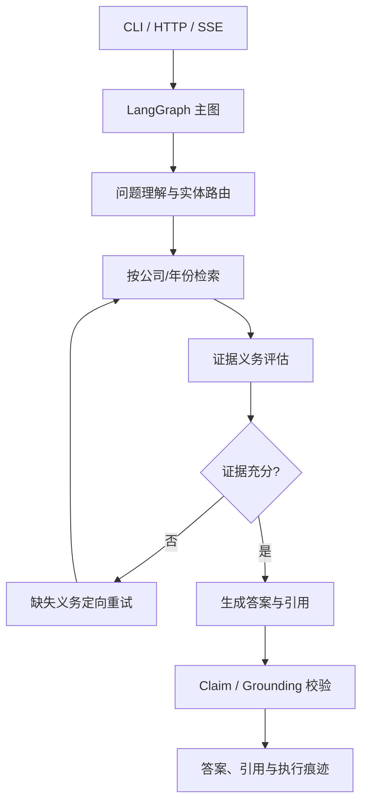

# kb-agent

[](https://github.com/1940633231/kb-agent/actions/workflows/tests.yml)

基于 LangGraph 的年报知识问答 Agent，重点解决多公司、多年份、跨文档检索中的
实体路由、证据完整性、答案审计和可复现评测。

项目不重做向量检索底座，而是在 `production-rag` 的 FAISS、BM25、RRF 和 rerank
之上增加一层可观测、可重试、可人工介入的编排逻辑。

## 这个项目解决什么问题

普通 RAG 在单公司、单年份、单文档问题上通常已经够用；一旦问题包含多个实体，
失败模式会迅速变得隐蔽：

- 多公司题只检索到其中一家，答案却看起来完整。
- 同一公司多年份题混入错误年份，数字本身又都真实存在。
- 全局 top-k 数量够，但某个公司或年份的证据义务没有覆盖。
- 重试后把其他公司/年份的片段重新带回上下文，造成证据污染。
- 生成答案引用了数字，但数字、公司、年份、指标没有绑定在同一片段。

本项目针对这些失败模式，把检索拆成显式 route，把问题拆成逐项证据义务，
并在生成后做数值、引用和 Claim 校验。

它重点优化的是 **Agent 编排可靠性**，而不是重写向量检索、BM25 或 reranker。

## 当前状态

| 模块 | 状态 |
|---|---|
| 30 家公司、90 份年报、37,958 chunk | 已完成并通过审计 |
| 120 题评测集 v2 | 已完成，`120 normal / 0 fail` |
| 证据义务与 Claim 门禁 | 已完成 |
| 多公司/多年份检索前路由 | 已完成 |
| L2 / L3a / L3b 消融 | 已完成，全部验收通过 |
| 三轮 hybrid L3b 生成 | 已完成 |
| 生成质量优化 | 下一阶段 |

最新评测统一使用：

```text
dataset = evals/golden_set_scaled_120.jsonl
manifest_sha256 = 9b91a2457f47afab5de9968f9dfebef72e72598abdf4e8a58ef95c4e1417d29f
```

详细交付状态见 [docs/final-handoff.md](docs/final-handoff.md)。

## 核心结果

### 检索与路由

| 档位 | Recall@5 | Route 覆盖 | 缺失义务率 | 重试率 | 平均秒/题 | 污染率 |
|---|---:|---:|---:|---:|---:|---:|
| L2 | 0.9762 | 0.9476 | 0.0762 | 0.0000 | 44.6214 | 0.0095 |
| L3a | 1.0000 | 0.9905 | 0.0000 | 0.0000 | 37.2332 | 0.0000 |
| L3b | 1.0000 | 0.9905 | 0.0000 | 0.0917 | 55.4650 | 0.0000 |

正式消融 `acceptance.all_passed=true`。详见
[docs/routing-ablation-results.md](docs/routing-ablation-results.md)。

### 生成

三轮 hybrid L3b，每轮 120 题：

| 指标 | 均值 |
|---|---:|
| 答案正确率 | 0.6603 |
| Claim 支持率 | 0.7988 |
| Grounding 通过率 | 0.9403 |
| 引用完整覆盖率 | 0.9930 |
| 拒答正确率 | 1.0000 |
| 上下文溢出率 | 0.0000 |
| 平均秒/题 | 92.8829 |

分题型答案正确率：

```text
fact = 0.6713
table = 0.7593
cross_document = 0.4889
```

生成质量仍是主要短板。详见
[docs/generation-eval-v2.md](docs/generation-eval-v2.md)。

这组结果说明：

- 路由层已经把文档召回、义务覆盖和跨文档污染控制住。
- 生成层仍然会在多值绑定、精确表格值和跨文档逐项输出上出错。
- 当前瓶颈已经从“找不找得到”转向“拿到证据后能不能稳定答对”。

## 架构



关键原则：

- route 绑定具体 `document_ids`，禁止跨公司、跨年份回退。
- 每个公司 × 年份 × 指标生成独立证据义务。
- 重试只补缺失义务对应 route。
- 生成前统一裁剪上下文预算。
- 生成后做数值落地、引用和 Claim 审计。

### 请求生命周期

一次问答的主路径：

1. `understand_query` 提取公司、年份、指标和问题类型。
2. 为每个公司 × 年份 × 指标生成 route 与 evidence obligation。
3. `retrieve_knowledge` 按 route 检索，并在 rerank 前后保留 provenance。
4. `grade_retrieval` 检查每个义务是否被对应文档及指标覆盖。
5. 缺失义务存在时，只对缺失 route 做定向重试。
6. `generate_answer` 在统一 token 预算内生成答案。
7. `verify_answer` 检查数值落地、实体年份绑定、引用和完整性。
8. 低置信度或硬门禁失败时进入人工审核或带声明作答。

### 模块边界

| 模块 | 负责 | 不负责 |
|---|---|---|
| `agent/` | 状态、路由、评分、重试、生成后校验 | 重写检索算法 |
| `rag_adapter/` | 包装 production-rag、PDFium、prompt | 复制 Agent 判定逻辑 |
| `api/` | HTTP 校验、SSE、错误映射、请求日志 | 决定是否重试 |
| `persistence/` | Checkpointer、Store 和审核幂等 | 业务评分 |
| `evals/` | 数据集、runner、消融和报告 | 修改线上运行时行为 |

## 快速开始

### 0. 前置条件

- Python 3.12
- Windows PowerShell 或等价 shell
- 本地 `production-rag` 仓库，与本项目同级
- 可用的 embedding / reranker 模型缓存
- 需要生成时配置 OpenAI-compatible LLM

### 1. 安装

```powershell
D:\Python\Python312\python.exe -m venv .venv
.\.venv\Scripts\python.exe -m pip install -r requirements.txt
.\.venv\Scripts\python.exe -m pip install -e ..\production-rag
Copy-Item .env.example .env
```

在 `.env` 中配置：

```text
LLM_BASE_URL=
LLM_API_KEY=
LLM_MODEL=
```

本地模型使用 `BAAI/bge-small-zh-v1.5` 和 `BAAI/bge-reranker-base`。
模型已缓存时可设置：

```powershell
$env:HF_HUB_OFFLINE="1"
```

常用环境变量：

| 变量 | 用途 | 是否必需 |
|---|---|---|
| `LLM_BASE_URL` | OpenAI-compatible API 地址 | 生成时必需 |
| `LLM_API_KEY` | LLM API Key | 生成时必需 |
| `LLM_MODEL` | 生成模型名 | 生成时必需 |
| `HF_HUB_OFFLINE` | 强制使用本地模型缓存 | 可选 |
| `KB_AGENT_PORT` | API 端口，默认 `8300` | 可选 |
| `KB_AGENT_GENERATE` | API 默认是否生成 | 可选 |
| `KB_AGENT_INTERRUPT` | 低置信度是否人工审核 | 可选 |
| `KB_AGENT_TOKEN_STREAM` | SSE 是否输出 token | 可选 |
| `POSTGRES_*` | Postgres Checkpointer / Store | 持久化时必需 |

PDF 和索引不提交 Git，首次运行需要抓取年报并灌库：

```powershell
.\.venv\Scripts\python.exe scripts\fetch_annual_reports.py `
  --targets configs\cninfo_targets.json `
  --years 2023 2024 2025 `
  --out-dir data\docs\annual_reports

.\.venv\Scripts\python.exe scripts\ingest_kb.py --strategy recursive
```

语料边界：

- `data/docs/annual_reports/metadata.json` 记录公告、PDF 链接、SHA256 与抓取状态。
- PDF 本体不进入 Git。
- `data/index/{strategy}/` 保存 FAISS、chunk metadata 和页码偏移。
- 索引重建不需要重新 embedding 已缓存模型，但 CPU 建库仍然较慢。

### 2. CLI 问答

```powershell
.\.venv\Scripts\python.exe scripts\ask.py `
  "贵州茅台2023年的营业收入是多少元？"

.\.venv\Scripts\python.exe scripts\ask.py `
  "宁德时代2023年与2025年的营业收入分别是多少？" `
  --no-generate

.\.venv\Scripts\python.exe scripts\ask.py `
  "贵州茅台与招商银行2023年的营业收入分别是多少？" `
  --rule-rewrite --verbose

.\.venv\Scripts\python.exe scripts\ask.py `
  "华为2024年的研发投入是多少？"
```

常用参数：

```text
--no-generate     只跑检索与评分
--rule-rewrite    改写使用规则兜底
--interrupt       低置信度时挂起人工审核
--postgres        使用 Postgres Checkpointer / Store
--verbose         打印完整执行痕迹
```

### 3. HTTP API

```powershell
.\.venv\Scripts\python.exe -m api
```

默认地址：`http://127.0.0.1:8300`

| 方法 | 路径 | 用途 |
|---|---|---|
| GET | `/health` | 服务状态 |
| POST | `/ask` | 同步问答 |
| POST | `/ask/stream` | SSE 进度与 token 流 |
| GET | `/threads/{id}` | 查看线程状态 |
| GET | `/threads/{id}/review` | 查看待审核项 |
| POST | `/threads/{id}/review` | 提交审核结果 |

同步问答示例：

```powershell
Invoke-RestMethod -Method Post `
  -Uri http://127.0.0.1:8300/ask `
  -ContentType application/json `
  -Body '{"question":"贵州茅台2023年的营业收入是多少元？","thread_id":"demo"}'
```

返回中重点看：

```text
answer                 最终答案
citations              引用与页码
status                 当前状态
routes                 本轮检索 route
route_coverage         route 到证据义务的覆盖
retrieval_score        评分、缺失义务与拒绝判定
retrieval_stats        检索数量、过滤、候选和查询统计
```

SSE 流会依次出现：

```text
progress  ->  节点级进度
token     ->  生成文本片段
answer    ->  最终结果
```

## 评测

### 120 题集合

`evals/golden_set_scaled_120.jsonl` v2：

| 类型 | 数量 |
|---|---:|
| 公司单点题 | 90 |
| 跨文档题 | 15 |
| 应拒答题 | 15 |
| 合计 | 120 |

每题包含：

- `expected_docs`
- `expected_keywords`
- `expected_values`
- `evidence_literals`
- `required_evidence`
- `required_claims`
- `route_expectations`
- `source_pages`

v2 修正了 3 道美的集团题的“营业收入/营业总收入”口径和千元单位，
并更新 manifest SHA。旧 v1 报告不可与新报告混比。

### 指标口径

| 指标 | 含义 |
|---|---|
| `doc_recall@5` | 期望文档进入 top-5 的比例 |
| `all_docs_hit@5` | 多文档题是否全部命中 |
| `evidence_obligation_coverage` | 公司/年份/指标证据义务覆盖率 |
| `route_obligation_coverage` | route 内证据义务覆盖率 |
| `missing_obligation_rate` | 存在缺失义务的题目比例 |
| `cross_document_contamination_rate` | 混入非期望公司/年份文档的比例 |
| `answer_value_rate` | 答案包含全部期望数值的比例 |
| `claim_support_rate` | 数值 Claim 能被证据支持的比例 |
| `grounding_verified_rate` | 答案数字能在相关证据中定位的比例 |
| `refusal_correctness` | 应拒答题正确拒答比例 |

### 数据审计

```powershell
.\.venv\Scripts\python.exe evals\audit_scaled_golden_set.py
```

期望结果：

```text
records = 120
normal = 120
fail = 0
```

### 路由消融

```powershell
.\.venv\Scripts\python.exe evals\run_routing_ablation.py `
  --limit 120 `
  --top-k 5 `
  --route-candidate-limit 50 `
  --resume
```

输出：

```text
evals/reports/routing_ablation_l2.json
evals/reports/routing_ablation_l3a.json
evals/reports/routing_ablation_l3b.json
evals/reports/routing_ablation_summary.json
evals/reports/layer_matrix.json
```

### 三轮 hybrid L3b 生成

```powershell
.\.venv\Scripts\python.exe evals\run_scaled_eval.py `
  --mode generation `
  --repeats 3 `
  --generation-mode hybrid `
  --max-retries 2 `
  --top-k 5 `
  --output scaled_generation.json
```

CPU rerank 是主要耗时项。建议在机器空闲时运行，并预留数小时。

### 验收门槛

路由消融：

```text
L3a doc_recall@5 >= 0.95
L3b route_obligation_coverage >= 0.95
L3b missing_obligation_rate <= 0.05
L3b retry_rate <= 0.0917
L3a/L3b cross_document_contamination_rate == 0
L3a single-company/single-year latency <= L2 * 1.10
```

生成评测：

```text
三轮全部完成
每轮 120 条逐题记录
context_overflow_rate == 0
报告 SHA 与当前 manifest 一致
```

### 测试

```powershell
.\.venv\Scripts\python.exe -m pytest tests -q -rs
```

当前：`198 passed, 1 skipped`。跳过项为未配置 Postgres。

## 关键设计取舍

### 为什么路由发生在检索前

如果先做全局检索再按公司/年份裁剪，错误候选已经进入了 rerank 池。
检索前 route 能把查询范围直接限制到具体 `document_ids`，避免：

- 同公司错误年份抢走 top-k；
- 多公司题被单一公司主导；
- 重试时重新混入其他实体。

### 为什么不把 top-k 数量当作证据完整性

top-k 只表示“返回了多少片段”，不表示“每个公司/年份/指标都有证据”。
因此证据义务逐个评分，缺失哪个就只重试哪个 route。

### 为什么不让 retry 重跑所有 query

全局重跑会把上一轮正确证据保留下来，同时把其他实体候选重新带进上下文。
定向重试只补缺失义务，并继续保留原有 route provenance。

### 为什么 PDF 使用 PDFium

部分银行年报使用字体子集，`pypdf` 抽取会出现乱码。PDFium 是当前唯一
保留的文本抽取路径，切片、embedding 和 FAISS 写入仍复用 production-rag。

### 为什么生成后还要 Claim 审计

引用编号存在不等于数字被正确支持。Claim 审计会检查：

- 数值是否出现在被引片段；
- 公司与年份是否绑定正确；
- 指标是否与问题一致；
- 多值题是否漏掉某个义务；
- 同一指标是否存在多口径歧义。

## 报告怎么读

| 文件 | 用途 |
|---|---|
| `routing_ablation_summary.json` | 三档路由指标、增量、延迟和验收 |
| `routing_ablation_l2.json` | L2 无路由逐题结果 |
| `routing_ablation_l3a.json` | L3a 检索前路由逐题结果 |
| `routing_ablation_l3b.json` | L3b 定向重试逐题结果 |
| `scaled_generation.json` | 三轮生成指标、逐题答案和失败归因 |
| `context_budget.json` | 上下文预算、裁剪和溢出 |
| `scaled_golden_set_audit.json` | 120 题源文审计 |
| `layer_matrix.json` | 同 manifest 下的 L2/L3a/L3b 汇总 |

## 常见问题

### 模型加载时报 AutoProcessor 或 tokenizer 错误

先用最小命令验证模型缓存：

```powershell
.\.venv\Scripts\python.exe -c "from sentence_transformers import SentenceTransformer; print(SentenceTransformer('BAAI/bge-small-zh-v1.5').get_sentence_embedding_dimension())"
```

偶发的 Hub/cache 读取失败可重试；持续失败时清理对应 HuggingFace cache 后重新下载。

### 为什么只测检索时仍然要求 LLM 配置

正常运行时不应这样。评测适配器会在 retrieval-only 模式设置 generation backend 为
`stub`。如果仍然初始化真实 LLM，检查是否绕过了 `eval_adapter._build_service()`。

### 为什么 Postgres 测试被跳过

本地没有配置 `POSTGRES_*` 或容器未启动。跳过不影响内存 Checkpointer 测试，
但不能验证跨进程恢复和审核幂等。

### 为什么单题很慢

主要耗时是 CPU 上的 Cross-Encoder rerank。hybrid L3b 平均约 92.88 秒/题，
跨文档题会执行多个 route。优先优化候选池、批处理或改用远端 rerank。

## 目录

```text
agent/          LangGraph 状态、节点、路由、证据与审计
api/            FastAPI、SSE、请求日志
rag_adapter/    production-rag 适配和年报 prompt
evals/          数据集、runner、消融与报告
persistence/    Postgres Checkpointer / Store
scripts/        抓取、灌库、CLI 与审核工具
tests/          单元、图、API、持久化和报告契约测试
docs/           设计、评测、交付与历史文档
```

## 已知限制

- 跨文档生成答案正确率为 `0.4889`，多值题仍容易漏答或错绑。
- Claim 支持率为 `0.798833`，低于 `0.8` 优化门槛。
- 美的集团三道题暴露了“正文概数 vs 精确表格值”问题，prompt 已强化但尚未完全解决。
- 表格在 PDF 抽取后是扁平文本，行列语义仍需模型推断。
- hybrid L3b 平均约 92.88 秒/题，瓶颈主要是 CPU reranker。
- Postgres 未配置时退化到内存 Checkpointer，不能跨进程恢复审核状态。
- 引用页码使用 chunk 起始页，跨页片段可能指向上一页。

## 下一阶段

1. 优化跨文档题的逐值输出与公司/年份/指标绑定。
2. 解决正文概数和精确表格值并存时的取值选择。
3. 将 Claim 支持率稳定提升到 `0.8+`。
4. 优化 rerank 延迟，减少跨文档题多 route 成本。

## 文档索引

| 文档 | 内容 |
|---|---|
| [final-handoff.md](docs/final-handoff.md) | 当前阶段最终交付说明 |
| [routing-ablation-results.md](docs/routing-ablation-results.md) | 120 题路由消融 |
| [generation-eval-v2.md](docs/generation-eval-v2.md) | 三轮 hybrid L3b 生成 |
| [reliability-and-corpus-plan.md](docs/reliability-and-corpus-plan.md) | 数据与可靠性补强计划 |
| [pre-retrieval-entity-routing-plan.md](docs/pre-retrieval-entity-routing-plan.md) | 检索前实体路由设计 |
| [rag_eval_integration.md](docs/rag_eval_integration.md) | rag-eval 平台接入 |
| [interview.md](docs/interview.md) | 项目讲解与追问材料 |
| [readme-archive.md](docs/readme-archive.md) | 旧版 README 与历史阶段记录 |
